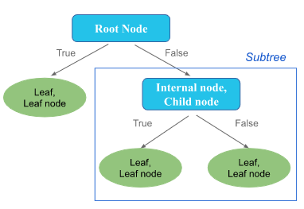

```{r setup, include=FALSE}
required_packages <- c("ISLR2", "ggplot2", "rpart", "rpart.plot", "vip",
                       "ranger", "randomForest", "gbm", "xgboost", "lightgbm")

for (pkg in required_packages) {
  if (!require(pkg, character.only = TRUE)) {
    install.packages(pkg, repos = "https://cloud.r-project.org")
    library(pkg, character.only = TRUE)
  }
}
```

# Decision Trees

A *decision tree* predicts an outcome by asking a sequence of simple questions about the predictors — *has the player been in the league for at least five years?*, *is the price above \$127?* — each answer sending the observation down one branch, until it reaches a *leaf* that holds the prediction. Trees can be used when the response is numeric (*regression trees*) and when it is categorical (*classification trees*), and they are among the few models that can be drawn on a page and read by someone with no statistical training.

A single tree, however, is rarely the most accurate model available. Its predictions change a great deal when the training data change slightly. The second half of the chapter shows how to fix that by combining many trees: *bagging* and *random forests* average trees grown on bootstrap samples, and *boosting* grows trees one after another, each correcting the errors of the previous ones. Two modern implementations of boosting, **XGBoost** and **LightGBM**, are today the standard first choice for prediction on tabular data.

Along the way, the chapter introduces the tools used to evaluate any predictive model: training, validation and test sets, cross-validation, and performance metrics for predicted classes, probabilities and numbers.

The chapter follows Chapter 8 of @james2021islr and Chapters 9–12 of @boehmke2019hands. The algorithm for growing a single tree is CART, introduced by @breiman1984cart.

## Anatomy of a Decision Tree

A decision tree is a hierarchy of nodes connected by branches, drawn upside down: the root at the top, the leaves at the bottom.



1. **Root node**: the topmost node. It contains the whole training set and asks the first question — the one that best separates the data into groups with different values of the response.

2. **Internal nodes**: the decision points below the root. Each asks a question about one predictor, such as $X_j < s$ for a numeric predictor or $X_j \in \{\text{Bad}\}$ for a categorical one.

3. **Branches**: the two possible answers to the question at a node. Every observation that satisfies the condition goes down one branch, every other observation goes down the other.

4. **Leaves (terminal nodes)**: the end points of the tree, where no further question is asked. Each leaf holds a prediction: the *mean* response of the training observations that reached it (regression), or their *most common class* (classification).

5. **Subtree**: any node together with everything below it. A subtree is itself a decision tree.

6. **Depth**: the number of questions between the root and a node. A tree of depth $1$, with a single split and two leaves, is called a *stump*.

Every path from the root to a leaf is a rule of the form *if this and this, then predict that*. A tree with $J$ leaves divides the space of the predictors into $J$ non-overlapping rectangular boxes $R_1, \ldots, R_J$, and predicts a constant in each box.

For an interactive introduction, see the [MLU-Explain decision tree tutorial](https://mlu-explain.github.io/decision-tree/).

:::{.callout-note appearance="minimal"}
**Packages and commands.** No code in this section. The chapter uses **rpart** for single trees (`rpart`, `printcp`, `plotcp`, `prune`) and **rpart.plot** to draw them, **randomForest** and **ranger** for bagging and random forests, **gbm** for gradient boosting, **xgboost** and **lightgbm** for their two modern implementations, **vip** for variable-importance plots, **ISLR2** for the data and **ggplot2** for the remaining figures. All are installed and loaded by the setup chunk at the top of the chapter.
:::

## The Data

We use three data sets from the package **ISLR2**, the companion package of @james2021islr. Each one plays a different role in the chapter.

| Data set | Rows | Response | Predictors | Used for |
|:-----------|-----:|:----------------------------------|-----:|:--------------------------------|
| `Hitters` | $263$ | `logSalary`: log of a baseball player's 1987 salary | $19$ | the first regression tree, splitting by hand, missing values |
| `Boston` | $506$ | `medv`: median house value of a census tract (\$1000s) | $12$ | regression trees, pruning and every ensemble method |
| `Carseats` | $400$ | `High`: does a store sell more than $8\,000$ car seats? | $10$ | classification trees, pruning and ensembles for classification |

**`Hitters`** describes $322$ Major League Baseball players: their 1986 season (`AtBat`, `Hits`, `HmRun`, `Runs`, `RBI`, `Walks`, `PutOuts`, `Assists`, `Errors`), their whole career (`Years` in the league and the career totals `CAtBat`, `CHits`, `CHmRun`, `CRuns`, `CRBI`, `CWalks`), their `League`, `Division` and `NewLeague`, and their 1987 `Salary` in thousands of dollars. The salary is missing for $59$ players, whom we drop, and it is strongly right-skewed, so we model its logarithm.

**`Boston`** describes $506$ census tracts of the Boston area in 1970 [@harrison1978hedonic]. The response `medv` is the median value of owner-occupied homes, in thousands of dollars. The predictors include the average number of rooms per dwelling (`rm`), the percentage of the population of lower socioeconomic status (`lstat`), the per-capita crime rate (`crim`), nitric-oxide concentration (`nox`), distance to employment centres (`dis`), the pupil–teacher ratio (`ptratio`) and the property-tax rate (`tax`). The values of `medv` were capped at $50$ when the data were collected; $16$ tracts sit at that cap.

**`Carseats`** is a simulated data set of child car seat sales at $400$ stores. We turn the numeric `Sales` (thousands of units) into a binary response `High`, equal to `"Yes"` when `Sales` exceeds $8$. The predictors are the store's `Price` and the competitor's price at the same location (`CompPrice`), the local `Advertising` budget, the `Income`, `Population`, `Age` and `Education` of the community, the quality of the shelving location (`ShelveLoc`: Bad, Medium or Good), and whether the store is `Urban` and in the `US`.

:::{.callout-note}
The original Boston data, as distributed in **MASS**, contain a variable `black`, defined as $1000(B - 0.63)^2$ where $B$ is the proportion of Black residents. Its parabolic form encodes the original authors' assumption about how racial self-segregation affects house prices, an assumption they did not test. The version in **ISLR2** leaves the variable out, and we use that version (see also the Data Ethics chapter).
:::

Every method is evaluated on data it has not seen. As in the labs of @james2021islr, each data set is split in half at random, and the same split is used for every model. For Boston, `set.seed(1)` gives the same split as the corresponding lab, and where we use the same method — a random forest with `mtry = 6`, for example — the numbers below match theirs. Why the data are split, and how the training half is used to make choices, is the subject of @sec-splitting.

```{r}
#| label: data
#| echo: false

hitters <- na.omit(ISLR2::Hitters)
hitters$logSalary <- log(hitters$Salary)
hitters$Salary <- NULL

carseats <- ISLR2::Carseats
carseats$High <- factor(ifelse(carseats$Sales > 8, "Yes", "No"))
carseats$Sales <- NULL

boston <- ISLR2::Boston

set.seed(1); hit_idx <- sample(nrow(hitters), nrow(hitters) / 2)
set.seed(1); car_idx <- sample(nrow(carseats), nrow(carseats) / 2)
set.seed(1); bos_idx <- sample(nrow(boston), nrow(boston) / 2)

hit_train <- hitters[hit_idx, ];  hit_test <- hitters[-hit_idx, ]
car_train <- carseats[car_idx, ]; car_test <- carseats[-car_idx, ]
bos_train <- boston[bos_idx, ];   bos_test <- boston[-bos_idx, ]
```

The code below creates the three data sets and the six training and test sets. Run it once: every interactive box in this chapter uses the objects it leaves behind.

```{webr-r}
#| label: data-webr
#| autorun: true
#| message: false
#| warning: false

library(ISLR2)

# Hitters: drop the 59 players without a salary, and model log(Salary)
hitters <- na.omit(ISLR2::Hitters)
hitters$logSalary <- log(hitters$Salary)
hitters$Salary <- NULL

# Carseats: binary response High = "Yes" when Sales exceed 8 (thousand units)
carseats <- ISLR2::Carseats
carseats$High <- factor(ifelse(carseats$Sales > 8, "Yes", "No"))
carseats$Sales <- NULL

boston <- ISLR2::Boston

# Half of each data set for training, half for testing
set.seed(1); hit_idx <- sample(nrow(hitters), nrow(hitters) / 2)
set.seed(1); car_idx <- sample(nrow(carseats), nrow(carseats) / 2)
set.seed(1); bos_idx <- sample(nrow(boston), nrow(boston) / 2)

hit_train <- hitters[hit_idx, ];  hit_test <- hitters[-hit_idx, ]
car_train <- carseats[car_idx, ]; car_test <- carseats[-car_idx, ]
bos_train <- boston[bos_idx, ];   bos_test <- boston[-bos_idx, ]

rbind(train = c(hitters = nrow(hit_train), carseats = nrow(car_train), boston = nrow(bos_train)),
      test  = c(nrow(hit_test), nrow(car_test), nrow(bos_test)))
```

:::{.callout-warning}
**XGBoost**, **LightGBM** and **ranger** do not currently run in the browser version of R used by this book (webR). The examples that use them are computed when the book is built, and their code can be copied into RStudio. Every other example can also be run, and changed, in the interactive boxes.
:::

:::{.callout-note appearance="minimal"}
**Packages and commands.** The data come from **ISLR2** (`Hitters`, `Carseats`, `Boston`). `na.omit` drops the players without a salary, `factor(ifelse(...))` builds the binary response, and `set.seed` followed by `sample(n, n / 2)` draws the training rows; negative indexing, `data[-idx, ]`, gives the test rows.
:::

## Regression Trees

### A First Example: Baseball Salaries

We start with only two predictors of `logSalary`: the number of `Years` a player has spent in the major leagues and the number of `Hits` in the previous season. The `rpart()` function of the **rpart** package grows the tree, and `rpart.plot()` of the **rpart.plot** package draws it. For now the argument `cp = 0.1` only keeps the tree small; it is explained in @sec-pruning.

```{r}
#| label: hitters-small
#| fig-cap: "A regression tree for the log salary of baseball players, using two predictors. Each leaf shows the mean log salary of its players and their share of the data."
#| fig-width: 6
#| fig-height: 4
library(rpart)
library(rpart.plot)

hit_small <- rpart(logSalary ~ Years + Hits, data = hitters,
                   control = rpart.control(cp = 0.1))
hit_small

rpart.plot(hit_small, type = 2, digits = 3)
```

The printed tree lists one node per line: its number, the split that leads to it, the number of players $n$, the *deviance* (for a regression tree, the residual sum of squares of the node) and `yval`, the mean `logSalary` of the node. Terminal nodes are marked with a `*`.

The tree has three leaves. The first question is about experience: players with fewer than $4.5$ years in the league form a leaf of their own. Among the more experienced players, the number of hits in the previous season makes the difference. On the original scale of the salaries:

```{r}
#| label: hitters-small-dollars
leaf_means <- hit_small$frame$yval[hit_small$frame$var == "<leaf>"]
round(1000 * exp(leaf_means))   # dollars
```

- players with less than $4.5$ years in the league: predicted salary $1000 \times e^{5.107} \approx \$165\,000$;
- experienced players with fewer than $117.5$ hits: $\$403\,000$;
- experienced players with at least $117.5$ hits: $\$845\,000$.

This tree is the one in Figure 8.1 of @james2021islr. It is easy to read: experience is the most important factor; for players with experience, past performance matters; for inexperienced players, in this tree, it does not. The tree is almost certainly an oversimplification of the true relationship, but the trade-off between simplicity and accuracy is exactly what the rest of the chapter is about.

The three leaves are three rectangles in the plane of the two predictors:

```{r}
#| label: hitters-partition
#| fig-cap: "The three regions of the tree above. Every player in a region receives the same prediction, the mean log salary of the training players in that region."
#| fig-width: 6
#| fig-height: 4.5
library(ggplot2)

ggplot(hitters, aes(Years, Hits)) +
  geom_point(aes(colour = logSalary), size = 1.8) +
  geom_vline(xintercept = 4.5, linewidth = 0.8) +
  annotate("segment", x = 4.5, xend = Inf, y = 117.5, yend = 117.5, linewidth = 0.8) +
  annotate("label", x = c(2, 14, 14), y = c(200, 50, 200),
           label = c("R[1]", "R[2]", "R[3]"), parse = TRUE, size = 5) +
  scale_colour_viridis_c(name = "log(Salary)") +
  theme_minimal()
```

```{webr-r}
#| label: hitters-small-webr
#| autorun: false
#| message: false
#| warning: false
library(rpart)
library(rpart.plot)

# Try it: replace Hits by another predictor (Walks, CRuns, HmRun, ...),
# or lower cp to 0.02 and see which splits are added
fit <- rpart(logSalary ~ Years + Hits, data = hitters,
             control = rpart.control(cp = 0.1))
rpart.plot(fit, type = 2, digits = 3)
```

### Recursive Binary Splitting

How does `rpart()` find these splits? The goal is to divide the predictor space into $J$ boxes $R_1, \ldots, R_J$ that minimise the *residual sum of squares*
$$
\text{RSS} = \sum_{j=1}^{J} \sum_{i \in R_j} \left(y_i - \hat{y}_{R_j}\right)^2 ,
$$
where $\hat{y}_{R_j}$ is the mean response of the training observations in box $R_j$. Checking every possible partition into boxes is computationally impossible, so CART uses a *top-down, greedy* approach called **recursive binary splitting**:

1. Start with all observations in a single region, the root.
2. For every predictor $X_j$ and every cut point $s$, consider the two half-planes
$$
R_1(j, s) = \{X \mid X_j < s\} \qquad \text{and} \qquad R_2(j, s) = \{X \mid X_j \geq s\},
$$
and choose the pair $(j, s)$ that minimises
$$
\sum_{i:\, x_i \in R_1(j,s)} \left(y_i - \hat{y}_{R_1}\right)^2 + \sum_{i:\, x_i \in R_2(j,s)} \left(y_i - \hat{y}_{R_2}\right)^2 .
$$
3. Apply step 2 to each of the two new regions separately, then to the regions that result, and so on.
4. Stop when a stopping rule is met, for example when every region contains fewer than a given number of observations.

The approach is *top-down* because it starts from the root and works its way down, and *greedy* because at each step it takes the best split *at that step*, without looking ahead to splits that might lead to a better tree later. A categorical predictor with $L$ levels is split by assigning each level to one of the two branches.

**Example**: five cars, sorted by weight (in thousands of pounds), and their fuel consumption in miles per gallon.

| Car | E | D | C | B | A |
|:----|---:|---:|---:|---:|---:|
| weight | $2.2$ | $2.6$ | $3.2$ | $3.6$ | $4.0$ |
| mpg | $22$ | $20$ | $15$ | $12$ | $10$ |

The mean mpg is $\bar{y} = 15.8$, and the RSS of the root is
$$
(22 - 15.8)^2 + (20 - 15.8)^2 + (15 - 15.8)^2 + (12 - 15.8)^2 + (10 - 15.8)^2 = 104.8 .
$$
There are four possible cut points, one between each pair of consecutive weights:

| Split | Left | Right | RSS left | RSS right | Total RSS |
|:-----------|:---------|:---------|-----:|-----:|-----:|
| weight $< 2.4$ | $22$ | $20, 15, 12, 10$ | $0$ | $56.75$ | $56.75$ |
| weight $< 2.9$ | $22, 20$ | $15, 12, 10$ | $2$ | $12.67$ | **$14.67$** |
| weight $< 3.4$ | $22, 20, 15$ | $12, 10$ | $26$ | $2$ | $28$ |
| weight $< 3.8$ | $22, 20, 15, 12$ | $10$ | $62.75$ | $0$ | $62.75$ |

For the best split, weight $< 2.9$, the left node has mean $21$ and RSS $(22-21)^2 + (20-21)^2 = 2$, and the right node has mean $12.33$ and RSS $(15-12.33)^2 + (12-12.33)^2 + (10-12.33)^2 = 12.67$. The split reduces the RSS from $104.8$ to $14.67$. A one-split tree in `rpart()` finds the same cut point:

```{r}
#| label: cars-by-hand
cars5 <- data.frame(weight = c(2.2, 2.6, 3.2, 3.6, 4.0),
                    mpg    = c(22, 20, 15, 12, 10))

rpart(mpg ~ weight, data = cars5,
      control = rpart.control(minsplit = 2, minbucket = 1, maxdepth = 1))
```

:::{.callout-note}
Dividing an RSS by the number of observations gives the variance of the node, or equivalently the mean squared error (MSE) of predicting every observation by the node mean. Minimising the total RSS of the two children is therefore the same as minimising their *weighted average variance*, with weights $n_L/n$ and $n_R/n$. Both descriptions appear in the literature.
:::

The same search, written as a short function, finds the root split of the baseball tree. For each candidate cut point it computes the total RSS of the two halves; the best cut point is the one with the smallest total.

```{r}
#| label: split-scan
#| fig-cap: "Total RSS of the two halves for every possible cut point of Years and of Hits. The horizontal line is the RSS of the root. The best split on Years reduces the RSS much more than the best split on Hits."
#| fig-width: 7
#| fig-height: 3.5
rss_split <- function(x, y, s) {
  left <- y[x < s]; right <- y[x >= s]
  sum((left - mean(left))^2) + sum((right - mean(right))^2)
}

scan_splits <- function(x, y) {
  u <- sort(unique(x))
  s <- (head(u, -1) + tail(u, -1)) / 2          # midpoints between observed values
  data.frame(s = s, rss = sapply(s, function(si) rss_split(x, y, si)))
}

y <- hitters$logSalary
scan_years <- scan_splits(hitters$Years, y)
scan_hits  <- scan_splits(hitters$Hits, y)

rbind(Years = scan_years[which.min(scan_years$rss), ],
      Hits  = scan_hits[which.min(scan_hits$rss), ],
      root  = c(NA, sum((y - mean(y))^2)))

scans <- rbind(cbind(predictor = "Years", scan_years),
               cbind(predictor = "Hits",  scan_hits))
ggplot(scans, aes(s, rss)) +
  geom_line() +
  geom_hline(yintercept = sum((y - mean(y))^2), linetype = "dashed") +
  facet_wrap(~ predictor, scales = "free_x") +
  labs(x = "cut point s", y = "total RSS of the two halves") +
  theme_minimal()
```

Splitting at `Years < 4.5` brings the RSS from $207.2$ down to $115.1$; the best split on `Hits` only reaches $161.0$. So the root asks about `Years`, as in the tree above. The tree then repeats the search inside each half, which is how `Hits < 117.5` is found for the experienced players.

Running the same search over the $16$ numeric predictors shows that the career totals are better predictors still:

```{r}
#| label: split-scan-all
num_vars <- names(hitters)[sapply(hitters, is.numeric) & names(hitters) != "logSalary"]
best <- t(sapply(num_vars, function(v) {
  sc <- scan_splits(hitters[[v]], y)
  unlist(sc[which.min(sc$rss), ])
}))
head(best[order(best[, "rss"]), ], 5)
```

The best root split is `CAtBat < 1452` — the number of times at bat over a career, which, like `Years`, measures experience. It is also the root that `rpart()` chooses with all $19$ predictors: the three factors `League`, `Division` and `NewLeague` have two levels each, so each allows a single split, and none of them comes close.

```{webr-r}
#| label: split-scan-webr
#| autorun: false
rss_split <- function(x, y, s) {
  left <- y[x < s]; right <- y[x >= s]
  sum((left - mean(left))^2) + sum((right - mean(right))^2)
}
scan_splits <- function(x, y) {
  u <- sort(unique(x))
  s <- (head(u, -1) + tail(u, -1)) / 2
  data.frame(s = s, rss = sapply(s, function(si) rss_split(x, y, si)))
}

# Try it: the second split of the tree is found by the same search,
# restricted to the experienced players
exp_players <- hitters[hitters$Years >= 4.5, ]
sc <- scan_splits(exp_players$Hits, exp_players$logSalary)
sc[which.min(sc$rss), ]
```

### Fitting Regression Trees with rpart

The `rpart()` function fits classification and regression trees with the CART algorithm. Its simplified format is
```{r}
#| eval: false
rpart(formula, data, method, parms, control, na.action = na.rpart)
```
where:

- `formula`: the response on the left of `~` and the predictors on the right; `.` means all other columns.
- `data`: the data frame containing the variables.
- `method`: `"anova"` for a regression tree, `"class"` for a classification tree (also `"poisson"` for counts and `"exp"` for survival data). If omitted, `rpart()` guesses from the type of the response: a factor gives a classification tree, a number a regression tree.
- `parms`: options of the splitting rule; for classification, `parms = list(split = "information")` uses the entropy instead of the Gini index.
- `control`: a list built with `rpart.control()` that controls how far the tree grows.
- `na.action`: the default `na.rpart` drops observations with a missing response but keeps those with missing predictors, which are handled by *surrogate splits* (@sec-surrogates).

The main options of `rpart.control()` are:

| Option | Default | Meaning |
|:----------|:------|:-----------------------------------------------|
| `minsplit` | $20$ | minimum number of observations in a node for a split to be attempted |
| `minbucket` | `round(minsplit / 3)` | minimum number of observations in a leaf |
| `maxdepth` | $30$ | maximum depth of any node, with the root at depth $0$ |
| `cp` | $0.01$ | complexity parameter: a split must improve the fit by at least this fraction of the root error (@sec-pruning) |
| `xval` | $10$ | number of cross-validation folds used to estimate the error of every subtree |
| `maxsurrogate`, `usesurrogate` | $5$, $2$ | number of surrogate splits kept, and how they are used for missing values |

We now fit a regression tree to the Boston training set, with all predictors and the default options.

```{r}
#| label: boston-tree
#| fig-cap: "Regression tree for the median house value (medv, in $1000s) of the Boston census tracts, grown on the training set with the default options of rpart."
#| fig-width: 7
#| fig-height: 4.5
bos_tree <- rpart(medv ~ ., data = bos_train)
bos_tree

rpart.plot(bos_tree, type = 2, digits = 3)
```

The tree has seven leaves and uses four of the twelve predictors. The first split is on `rm`, the average number of rooms: the $31$ tracts with $\text{rm} \geq 6.96$ have a mean value of $\$39\,200$, and are split again at $7.55$ rooms into tracts worth $\$33\,400$ and $\$45\,400$. Among the other $222$ tracts, the next question is about `lstat`: where more than $14.4\%$ of the population is of lower status, values are lower, and lowest of all ($\$10\,300$) where the crime rate also exceeds $11.5$. Where `lstat` is below $14.4\%$, the number of rooms appears again.

**The `rpart` object.** `rpart()` returns an object of class `"rpart"`: a list whose components hold everything that is known about the tree. Printing it gives the table above, but the components can also be used directly.

```{r}
#| label: rpart-object
class(bos_tree)
names(bos_tree)
```

| Component | Contents |
|:-----------------------|:---------------------------------------------------------------|
| `frame` | one row per node, in the order of the printed tree: the split variable `var` (`"<leaf>"` for a leaf), the number of observations `n` and their total weight `wt`, the deviance `dev`, the prediction `yval`, the `complexity` parameter at which the node's split would be pruned, and the numbers of competing (`ncompete`) and surrogate (`nsurrogate`) splits kept. A classification tree adds `yval2`, with the class counts and proportions of each node |
| `splits` | one row per split kept: for each internal node, the split used, the best competing splits on other variables and the surrogate splits |
| `csplit` | for splits on a factor, which levels go left and which go right (only present when the tree splits a factor) |
| `where` | for each training observation, the row of `frame` of the leaf it falls into |
| `cptable` | the complexity table, with the cross-validated error of every subtree (@sec-pruning) |
| `variable.importance` | the importance score of each variable (@sec-importance) |
| `method`, `parms`, `control` | the kind of tree (`"anova"`, `"class"`, ...), the parameters of the splitting rule, and the options of `rpart.control()` that were used |
| `call`, `terms`, `y` | the call, the model formula, and the response of the training observations |

The table `frame` is the printed tree in the form of a data frame:

```{r}
#| label: rpart-frame
bos_tree$frame[, c("var", "n", "dev", "yval", "complexity", "ncompete", "nsurrogate")]
```

Its row names are the node numbers of the printed tree. The root is node $1$, and the two children of node $k$ are nodes $2k$ and $2k + 1$: node $9$ is split into nodes $18$ and $19$, and node $k$ lies at depth $\lfloor \log_2 k \rfloor$. The deviance of the root, $19\,447.9$, is its RSS, $\sum_i (y_i - \bar{y})^2$; the deviance of every other node is the RSS of its tracts around their mean `yval`.

The vector `where` gives, for each training tract, the leaf it falls into — as a *row number* of `frame`, not as a node number:

```{r}
#| label: rpart-where
head(bos_tree$where)                                       # rows of frame
table(node = rownames(bos_tree$frame)[bos_tree$where])     # tracts in each leaf

# the fitted value of a training tract is the yval of its leaf
all.equal(unname(predict(bos_tree)), bos_tree$frame$yval[bos_tree$where])
```

The first training tract, number $505$ of the Boston data, falls in row $10$ of `frame`, which is node $11$. Every tract in a leaf is predicted by the mean of the leaf, so the fitted values of the training tracts are simply `frame$yval[where]`.

The matrix `splits` records the splits that `rpart()` considered at each node. Its first ten rows describe the root, for which `frame` reports $4$ competing and $5$ surrogate splits:

```{r}
#| label: rpart-splits
round(bos_tree$splits[1:10, ], 3)
```

The first row is the split that was used: `rm` at the cut point `index` $= 6.96$. The next four are the best splits on four other variables, the *competing* splits, and the last five are the *surrogate* splits, used for observations whose value of `rm` is missing (@sec-surrogates). For the split used and its competitors, `count` is the number of observations and `improve` the share of the node's deviance that the split removes: $(19\,447.9 - 6\,794.3 - 1\,929.0) / 19\,447.9 = 0.551$ for `rm`, against $0.471$ for the best split on `lstat`. For a surrogate, `improve` holds instead its agreement with the split used, and `adj` the adjusted agreement. The sign of `ncat` gives the direction of the split: $-1$ when the observations below the cut point go to the left child, $+1$ when those above it do. For a factor, `ncat` is its number of levels, and the levels sent to each side are stored in `csplit`.

Finally, `rpart.rules()` of **rpart.plot** writes the path from the root to each leaf as a rule, one line per leaf, sorted by prediction:

```{r}
#| label: rpart-rules
rpart.rules(bos_tree, digits = 3)
```

Each line reads as an *if–then* rule: if the average number of rooms is below $6.96$, more than $14.4\%$ of the population is of lower status and the crime rate exceeds $11.5$, then the predicted median value is $\$10\,300$.

To judge the tree we predict the test set and compare with two benchmarks: a linear regression on the same predictors, and the *null model* that predicts every tract by the mean of the training set.

```{r}
#| label: boston-tree-mse
mse <- function(pred, obs) mean((pred - obs)^2)

c(tree   = mse(predict(bos_tree, bos_test), bos_test$medv),
  linear = mse(predict(lm(medv ~ ., data = bos_train), bos_test), bos_test$medv),
  null   = mse(mean(bos_train$medv), bos_test$medv))
```

The test MSE of the tree is $35.29$: its predictions are, on a root-mean-square basis, $\sqrt{35.29} \approx 5.94$ thousand dollars away from the true median values. The tree is far better than the null model, but it is beaten by a plain linear regression ($27.65$). We will see that pruning hardly changes this, and that a forest of trees changes it a lot.<!-- (Over $100$ other random splits of the data, however, the tree beats the linear regression two times out of three: see @sec-split-sensitivity.) -->

The appearance of the tree is controlled by the arguments of `rpart.plot()`, whose simplified format is
```{r}
#| eval: false
rpart.plot(x, type = 2, extra = "auto", digits = 2, fallen.leaves = TRUE,
           box.palette = "auto", roundint = TRUE, tweak = 1)
```
where `x` is a tree fitted by `rpart()`, `digits` the number of significant digits, `fallen.leaves = TRUE` draws all leaves at the bottom, `box.palette` colours the nodes by their prediction, `roundint = TRUE` rounds split points of integer predictors, and `tweak` enlarges (`tweak > 1`) or shrinks the text. The arguments `type` and `extra` select what is drawn:

| `type` | Labels |
|:-----|:-------------------------------------------------|
| `0` | a split label at each split, node labels at the leaves only |
| `1` | as `0`, but all nodes are labelled |
| `2` | as `1`, with the split labels below the node labels (default) |
| `3` | separate split labels for the left and right branches |
| `4` | as `3`, with all nodes labelled |
| `5` | the split variable name in the interior nodes |

| `extra` | Extra information in each node |
|:-----|:-------------------------------------------------|
| `"auto"` | `106` for binary classification, `104` for more classes, `100` for regression |
| `0` | none |
| `1` | number of observations (per class, for classification) |
| `2` | classification rate (correct / total) |
| `4` | probability of each class |
| `6` | probability of the second class only (useful for a binary response) |
| `8` | probability of the predicted class |
| `+ 100` | adds the percentage of observations in the node |

```{webr-r}
#| label: boston-tree-webr
#| autorun: false
#| message: false
#| warning: false
library(rpart)
library(rpart.plot)

# Try it: change minsplit, minbucket or maxdepth and watch the test MSE
fit <- rpart(medv ~ ., data = bos_train,
             control = rpart.control(minsplit = 20, minbucket = 7, maxdepth = 30))
rpart.plot(fit, type = 2, digits = 3)

c(leaves   = sum(fit$frame$var == "<leaf>"),
  test_mse = mean((predict(fit, bos_test) - bos_test$medv)^2))
```

:::{.callout-note appearance="minimal"}
**Packages and commands.** **rpart**'s `rpart(formula, data, method = "anova", control = rpart.control())` grows the tree and returns an object of class `"rpart"`; printing it lists every node with its `n`, deviance and `yval`, and `fit$frame` holds the same table (`var == "<leaf>"` marks the leaves). `fit$where` gives the leaf of each training observation, `fit$splits` the splits used, their competitors and their surrogates, and `fit$cptable` the complexity table. `predict(fit, newdata)` predicts new observations and `residuals(fit)` gives the training residuals. **rpart.plot**'s `rpart.plot(fit, type = , extra = , digits = )` draws the tree, and `rpart.rules(fit)` writes it as a set of rules. The split search by hand uses only base R (`sort`, `unique`, `sapply`, `which.min`), and `lm` gives the linear benchmark. The figures use **ggplot2**.
:::

## Classification Trees

A *classification tree* predicts a qualitative response. Each leaf predicts the *most common class* among the training observations that reach it, and the class proportions in the leaf serve as estimates of the class probabilities. The tree is grown by recursive binary splitting, as before, but the RSS is no longer a sensible measure of how good a split is. It is replaced by a measure of the *impurity* of a node.

### Measures of Node Impurity

Let $\hat{p}_{mk}$ be the proportion of training observations in node $m$ that belong to class $k$, for $k = 1, \ldots, K$. Three measures of impurity are in common use.

**Classification error**: the fraction of observations in the node that do not belong to its most common class,
$$
E_m = 1 - \max_k \hat{p}_{mk} .
$$

**Gini index**:
$$
G_m = \sum_{k=1}^{K} \hat{p}_{mk}\,(1 - \hat{p}_{mk}) = 1 - \sum_{k=1}^{K} \hat{p}_{mk}^2 .
$$
The Gini index is $0$ when the node is *pure* (all of its observations belong to one class) and is largest when the classes are equally represented: $0.5$ for two classes. A node with $90\%$ of one class and $10\%$ of another has $G = 1 - (0.9^2 + 0.1^2) = 0.18$.

**Entropy**:
$$
D_m = - \sum_{k=1}^{K} \hat{p}_{mk} \log_2 \hat{p}_{mk} ,
$$
with $0 \log_2 0 = 0$. The entropy is also $0$ for a pure node, and reaches $1$ for two equally represented classes. The reduction of entropy produced by a split is called the *information gain*.

The impurity of a split is the weighted average of the impurities of its two children, $\frac{n_L}{n} I_L + \frac{n_R}{n} I_R$, and the best split is the one that reduces impurity the most.

```{r}
#| label: impurity-curves
#| fig-cap: "The three impurity measures for a two-class node, as a function of the proportion p of the second class. The entropy is divided by two so that all three curves reach 0.5 at p = 0.5."
#| fig-width: 6
#| fig-height: 3.8
p <- seq(0.001, 0.999, length.out = 200)
impurity <- data.frame(
  p = rep(p, 3),
  value = c(1 - pmax(p, 1 - p),
            2 * p * (1 - p),
            -(p * log2(p) + (1 - p) * log2(1 - p)) / 2),
  measure = rep(c("Classification error", "Gini index", "Entropy / 2"), each = length(p))
)
ggplot(impurity, aes(p, value, colour = measure)) +
  geom_line(linewidth = 1) +
  labs(x = "proportion of the second class", y = "impurity", colour = NULL) +
  theme_minimal()
```

The Gini index and the entropy are numerically very similar, and they are both smooth and strictly concave. The classification error has a kink and is linear on each side of it. That is why it is a poor criterion for *growing* a tree: it is not sensitive enough to changes in the node proportions. Consider a node with $400$ observations of each of two classes and two candidate splits [@hastie2009elements]:

- split A produces children with $(300, 100)$ and $(100, 300)$ observations;
- split B produces children with $(200, 400)$ and $(200, 0)$ observations.

```{r}
#| label: impurity-example
class_error <- function(n) 1 - max(n) / sum(n)
gini        <- function(n) { p <- n / sum(n); 1 - sum(p^2) }
entropy     <- function(n) { p <- n[n > 0] / sum(n); -sum(p * log2(p)) }

split_impurity <- function(f, left, right) {
  (sum(left) * f(left) + sum(right) * f(right)) / (sum(left) + sum(right))
}

sapply(list(error = class_error, gini = gini, entropy = entropy), function(f)
  c(parent  = f(c(400, 400)),
    split_A = split_impurity(f, c(300, 100), c(100, 300)),
    split_B = split_impurity(f, c(200, 400), c(200, 0))))
```

Both splits misclassify $200$ observations, so the classification error cannot tell them apart ($0.25$ for both). The Gini index and the entropy prefer split B, which creates a *pure* node — a node that never needs to be split again. For this reason trees are grown with the Gini index or the entropy. The classification error is the natural measure of the *final* tree, and it can be used to prune it if accuracy is the goal [@james2021islr].

`rpart()` uses the Gini index by default; `parms = list(split = "information")` selects the entropy.

### A First Example: Iris

The `iris` data set contains four measurements of $150$ iris flowers of three species, *setosa*, *versicolor* and *virginica*: `Sepal.Length`, `Sepal.Width`, `Petal.Length` and `Petal.Width`, in centimetres.


```{r}
#| label: iris-tree
#| fig-cap: "Classification tree for the species of iris flowers. Each node shows the predicted species, the proportion of each species in the node, and the percentage of all flowers in the node."
#| fig-width: 6
#| fig-height: 4
iris_tree <- rpart(Species ~ ., data = iris, method = "class")
iris_tree

rpart.plot(iris_tree, type = 2, extra = 104, fallen.leaves = TRUE)
```

For a classification tree the printed output gives, for each node, the number of observations, the `loss` (the number of observations *not* in the predicted class), the predicted class `yval` and the class proportions `yprob`. The tree has three leaves:

- if `Petal.Length` $< 2.45$, then *setosa*: the $50$ flowers in this leaf are all setosa;
- if `Petal.Length` $\geq 2.45$ and `Petal.Width` $< 1.75$, then *versicolor*: $91\%$ of the $54$ flowers in this leaf are versicolor and $9\%$ virginica;
- if `Petal.Length` $\geq 2.45$ and `Petal.Width` $\geq 1.75$, then *virginica*: $98\%$ of the $46$ flowers are virginica.

The plot rounds the cut points to two digits ($2.5$ and $1.8$). Versicolor and virginica are harder to separate than setosa, and the tree misclassifies $6$ of the $150$ flowers, an accuracy of $96\%$ on the data it was grown on.

:::{.callout-note}
**Why only two variables appear in the tree?** The tree does not try to use every variable; at each node it picks the one that separates the classes best. In the iris data the petal measurements are much more distinctive between species than the sepal measurements, so the algorithm finds that `Petal.Length` and `Petal.Width` alone classify almost perfectly. If we removed the petal variables and grew a new tree, the sepal variables would appear instead.
:::

### Predicting High Sales: Carseats

We now grow a classification tree for `High` on the Carseats training set.

```{r}
#| label: carseats-tree
#| fig-cap: "Classification tree for High sales at the Carseats stores. Each node shows the predicted class, the proportion of stores with High = Yes, and the percentage of stores in the node."
#| fig-width: 7
#| fig-height: 4.5
car_tree <- rpart(High ~ ., data = car_train, method = "class")
car_tree

rpart.plot(car_tree, type = 2, extra = 106)
```

The most important predictor is the price the store charges. The $27$ stores with a price below \$$91.5$ have high sales in $85\%$ of cases. Among the others, the price matters *relative to the competitor's*: where the competitor charges less than \$$121.5$, only $11\%$ of stores have high sales. Where the competitor is more expensive, a price below \$$127$ and a shelving location that is not *Bad* give a high chance of high sales ($83\%$). Notice that the split on `ShelveLoc` sends two of its three levels, *Good* and *Medium*, down the same branch.

On the test set:

```{r}
#| label: carseats-tree-test
car_pred <- predict(car_tree, car_test, type = "class")
table(predicted = car_pred, actual = car_test$High)
mean(car_pred == car_test$High)
```

The tree classifies $81 + 52 = 133$ of the $200$ test stores correctly, an accuracy of $66.5\%$. Of the $81$ stores with high sales it finds $52$.

With `type = "prob"`, `predict()` returns the class proportions of the leaf that each store falls into. A tree with six leaves can only produce six different probabilities:

```{r}
#| label: carseats-tree-prob
head(predict(car_tree, car_test, type = "prob"))
table(round(predict(car_tree, car_test, type = "prob")[, "Yes"], 3))
```

Growing the same tree with the entropy instead of the Gini index:

```{r}
#| label: carseats-tree-entropy
car_tree_info <- rpart(High ~ ., data = car_train, method = "class",
                       parms = list(split = "information"))
c(leaves   = sum(car_tree_info$frame$var == "<leaf>"),
  accuracy = mean(predict(car_tree_info, car_test, type = "class") == car_test$High))
```

The entropy produces a tree with one more leaf and a test accuracy of $69.5\%$ instead of $66.5\%$. The difference is six stores out of $200$, within the noise of a test set this size; in general the two criteria give very similar trees.

```{webr-r}
#| label: carseats-tree-webr
#| autorun: false
#| message: false
#| warning: false
library(rpart)
library(rpart.plot)

# Try it: compare split = "gini" and split = "information", and remove Price
# from the predictors (High ~ . - Price). Which variable takes its place?
fit <- rpart(High ~ ., data = car_train, method = "class",
             parms = list(split = "gini"))
rpart.plot(fit, type = 2, extra = 106)
mean(predict(fit, car_test, type = "class") == car_test$High)
```

:::{.callout-note appearance="minimal"}
**Packages and commands.** `rpart(method = "class")` grows a classification tree with the Gini index, or with the entropy when `parms = list(split = "information")`. `predict(fit, newdata, type = "class")` returns the predicted classes and `type = "prob"` the class proportions of the leaves; `table` cross-tabulates predictions and true classes, and `mean(pred == obs)` gives the accuracy. `rpart.plot(extra = 104)` shows all class probabilities, `extra = 106` only the probability of the second class. The impurity measures are short base-R functions.
:::

## Training, Validation and Test Sets {#sec-splitting}

A model is built to predict observations it has not seen. Its error on the observations it was fitted to, the *training error*, is a poor guide to how well it does that: it measures how closely the model has adapted to those particular observations, and a flexible model can adapt very closely. A tree grown until each leaf holds a single observation has a training error of zero, and yet it predicts new observations badly (@sec-pruning). What we want to know is the *test error*: the expected error on new observations from the same population. It can only be estimated with observations that played no part in building the model.

### Three Sets for Three Tasks

Besides fitting the model, building a predictive model involves two tasks that need data of their own [@hastie2009elements, Section 7.2]:

- **model selection**: comparing candidate models and choosing their *tuning parameters* — the size of a tree, the number of predictors sampled by a random forest, the learning rate of boosting;
- **model assessment**: estimating the test error of the final model, once it has been chosen.

When data are plentiful, they are split at random into three parts, one for each task. @hastie2009elements suggest $50\%$, $25\%$ and $25\%$ as a typical split.

| Set | Used to | Typical share |
|:-----------|:----------------------------------------------------|-----:|
| training | fit every candidate model: find its splits and leaf predictions | $50\%$ |
| validation | estimate the error of every candidate, and choose the best one | $25\%$ |
| test | estimate the error of the chosen model, once, at the end | $25\%$ |

The test set must be kept apart from the validation set because the validation error of the winning model is itself optimistic. It is the smallest of several noisy estimates, and it is the smallest partly by luck. A test set that has never been used to make a choice gives an honest estimate.

When data are scarce, setting a quarter of them aside for validation is wasteful. The validation set is then replaced by *cross-validation* inside the training set, described below, and the data are split in two only. That is what this chapter does: each data set is split in half, every choice is made on the training half — by cross-validation, or by the out-of-bag error of @sec-oob — and the test half is used only to compare the final models.

### The Validation-Set Approach

To see the three sets at work, we split the Boston training half once more: two thirds of its $253$ tracts for fitting the candidate models, and the remaining third for validating them. The test half is not touched. The candidates are regression trees that differ in a single tuning parameter, the minimum number $m$ of tracts in a leaf (the option `minbucket` of `rpart.control()`). With $m = 1$ a leaf can hold a single tract and the tree can follow the training data very closely; with a large $m$ the tree has only a few large leaves.

```{r}
#| label: validation-split
set.seed(1)
val_idx <- sample(nrow(bos_train), round(nrow(bos_train) / 3))
bos_fit <- bos_train[-val_idx, ]   # 169 tracts to fit the candidate trees
bos_val <- bos_train[val_idx, ]    #  84 tracts to validate them

# a tree whose leaves hold at least m tracts (cp = 0: no other limit on its size)
leaf_tree <- function(data, m) {
  rpart(medv ~ ., data = data, control = rpart.control(cp = 0, minbucket = m, xval = 0))
}

m_grid <- c(1, 2, 3, 5, 7, 10, 15, 20, 30, 50)
val_curve <- t(sapply(m_grid, function(m) {
  fit <- leaf_tree(bos_fit, m)
  c(m          = m,
    leaves     = sum(fit$frame$var == "<leaf>"),
    training   = mse(predict(fit), bos_fit$medv),
    validation = mse(predict(fit, bos_val), bos_val$medv))
}))
round(val_curve, 2)
```

```{r}
#| label: validation-curve
#| fig-cap: "Training and validation MSE of regression trees for the Boston data, against the minimum leaf size m (log scale). The trees are fitted to 169 tracts of the training half and validated on the other 84. The dotted line marks the leaf size with the smallest validation error."
#| fig-width: 7
#| fig-height: 4
m_best <- unname(val_curve[which.min(val_curve[, "validation"]), "m"])

curves <- data.frame(m   = rep(m_grid, 2),
                     mse = c(val_curve[, "training"], val_curve[, "validation"]),
                     set = rep(c("training", "validation"), each = length(m_grid)))
ggplot(curves, aes(m, mse, colour = set)) +
  geom_line(linewidth = 0.8) +
  geom_point() +
  geom_vline(xintercept = m_best, linetype = "dotted") +
  scale_x_log10(breaks = m_grid) +
  labs(x = "minimum leaf size m", y = "MSE", colour = NULL) +
  theme_minimal()
```

From left to right the trees become smaller, from $110$ leaves with $m = 1$ to two leaves with $m = 50$. The training error only increases: the larger the tree, the closer it follows the data it was grown on, down to an MSE of $0.22$ for $m = 1$. The validation error is U-shaped. It is high on the left, where large trees fit the noise of the $169$ tracts (*overfitting*: low bias, high variance), and high on the right, where trees with two or three leaves miss most of the structure (*underfitting*: high bias). It is lowest at $m = 7$, with a tree of $12$ leaves.

Once $m$ is chosen, the tree is grown again on the whole training half — more data give a better tree — and the test half is used, once, to estimate its error:

```{r}
#| label: validation-final
bos_final <- leaf_tree(bos_train, m_best)
c(m        = m_best,
  leaves   = sum(bos_final$frame$var == "<leaf>"),
  test_mse = mse(predict(bos_final, bos_test), bos_test$medv))
```

The final tree has $20$ leaves and a test MSE of $32.8$. It is more than twice the validation error of $14.2$. Part of the gap is the optimism of the validation error after a choice has been made; most of it comes from the test half of Boston, which is harder to predict than the training half (@sec-oob).

### Cross-Validation

The validation-set approach has two drawbacks [@james2021islr, Section 5.1]. The models are fitted to only part of the training data, so they are worse than the model that will finally be used, and the validation error tends to *overestimate* its test error. And the estimate depends on which observations happen to fall in the validation set: with $84$ tracts, a few hard tracts more or less change it noticeably.

**$K$-fold cross-validation** uses every observation for both purposes. The training set is divided at random into $K$ groups, or *folds*, of about equal size. Each fold in turn serves as the validation set for a model fitted to the other $K - 1$ folds, giving $K$ estimates $\text{MSE}_1, \ldots, \text{MSE}_K$, and the cross-validation estimate is their average,
$$
\text{CV}_{(K)} = \frac{1}{K} \sum_{k=1}^{K} \text{MSE}_k .
$$
Every observation is used for validation exactly once and for fitting $K - 1$ times. With $K = n$, each fold holds a single observation: this is *leave-one-out cross-validation* (LOOCV). The usual choices, $K = 5$ or $K = 10$, are cheaper and have been found to give a good balance between the bias and the variance of the estimate [@james2021islr, Section 5.1.4].

```{r}
#| label: cv-folds
cv_mse <- function(data, m, folds) {
  mean(sapply(unique(folds), function(k) {
    fit <- leaf_tree(data[folds != k, ], m)
    mse(predict(fit, data[folds == k, ]), data$medv[folds == k])
  }))
}

set.seed(1)
folds <- sample(rep(1:10, length.out = nrow(bos_train)))   # a fold number for every tract
table(folds)

cv_curve <- sapply(m_grid, function(m) cv_mse(bos_train, m, folds))
round(rbind(m = m_grid, cv_mse = cv_curve), 2)
```

The same folds are used for every value of $m$, so that the comparison between candidates is not blurred by differences between folds. To compare the stability of the two approaches, we repeat each of them ten times, with ten different random validation sets and ten different random assignments of the tracts to folds:

```{r}
#| label: cv-variability
#| fig-cap: "Left: validation MSE for ten random validation sets of 84 tracts. Right: 10-fold cross-validation MSE for ten random assignments of the tracts to folds. Both use the Boston training half; each line is one repetition."
#| fig-width: 8
#| fig-height: 3.8
one_run <- function(s) {
  set.seed(s)
  vi <- sample(nrow(bos_train), round(nrow(bos_train) / 3))
  set.seed(s)
  f  <- sample(rep(1:10, length.out = nrow(bos_train)))
  val <- sapply(m_grid, function(m)
    mse(predict(leaf_tree(bos_train[-vi, ], m), bos_train[vi, ]), bos_train$medv[vi]))
  cv  <- sapply(m_grid, function(m) cv_mse(bos_train, m, f))
  data.frame(run = s, m = rep(m_grid, 2), mse = c(val, cv),
             method = rep(c("validation set", "10-fold cross-validation"), each = length(m_grid)))
}
runs <- do.call(rbind, lapply(1:10, one_run))
runs$method <- factor(runs$method, levels = c("validation set", "10-fold cross-validation"))

ggplot(runs, aes(m, mse, group = run)) +
  geom_line(colour = "grey35", alpha = 0.7) +
  facet_wrap(~ method) +
  scale_x_log10(breaks = m_grid) +
  labs(x = "minimum leaf size m", y = "estimated MSE") +
  theme_minimal()

# the leaf size chosen by each repetition (one column per repetition)
chosen <- sapply(split(runs, runs$method), function(d)
  sapply(split(d, d$run), function(r) r$m[which.min(r$mse)]))
t(chosen)
```

The ten validation curves differ in level and in shape, and the leaf size they choose ranges from $1$ to $7$. The ten cross-validation curves have the same shape and choose $m = 3$, $5$ or $7$. Averaging them — *repeated cross-validation* — would give a still more stable estimate.

Cross-validation is used throughout the chapter. `rpart()` runs a 10-fold cross-validation every time it grows a tree, which @sec-pruning uses to choose the size of the tree; random forests offer a cheaper alternative, the out-of-bag error (@sec-oob); and **gbm**, **xgboost** and **lightgbm** have cross-validation functions of their own.

### Stratified Splits

A random split can, by chance, give the two halves different distributions of the response. In Carseats, $41\%$ of the $400$ stores have high sales; the training half has $41.5\%$ and the test half $40.5\%$, which is close. Over many random splits, however, the proportion in the training half varies quite a lot:

```{r}
#| label: stratified
set.seed(1)
props <- replicate(1000, mean(carseats$High[sample(400, 200)] == "Yes"))
quantile(props, c(0.025, 0.5, 0.975))

# sample half of the rows of each class separately
stratified_half <- function(y) {
  unlist(lapply(split(seq_along(y), y), function(rows) sample(rows, round(length(rows) / 2))))
}

set.seed(1)
strat_idx <- stratified_half(carseats$High)
c(train = mean(carseats$High[strat_idx] == "Yes"), test = mean(carseats$High[-strat_idx] == "Yes"))
```

In $95\%$ of random splits the training half has between $36.5\%$ and $45.5\%$ of high-sales stores. A *stratified* split samples separately within each class, so that both halves have exactly the class proportions of the whole data set. Stratifying matters most when one class is rare — in a data set with $6\%$ of positive cases, such as the `Caravan` data of Exercise 6, a random training set may contain very few of them — and for cross-validation folds, which are smaller still. For a numeric response, the same idea is applied to groups defined by its quantiles, for example the quartiles of `medv`. We keep the simple random splits of the labs of @james2021islr, so that the numbers can be compared with theirs.

The iris data of the classification section have $50$ flowers of each species. A stratified split puts $25$ of each species in each half; we use these halves to evaluate the iris tree in @sec-metrics.

```{r}
#| label: iris-split
set.seed(1)
iris_idx   <- stratified_half(iris$Species)
iris_train <- iris[iris_idx, ]
iris_test  <- iris[-iris_idx, ]
table(iris_train$Species)
```

### Rules for an Honest Estimate

- **Use the test set once.** If several models are compared on the test set and the best one is kept, its test error is optimistic for the same reason as a validation error.
- **Learn everything from the training data.** Every step that learns from data is part of the model: imputing missing values, standardising the predictors, *selecting* predictors<!-- (@sec-selection) -->, choosing tuning parameters. Each step must use the training set alone, and with cross-validation it must be repeated inside every fold. When information from the test set reaches the model this way, the estimate is optimistic; this is called *data leakage*.
- **Respect the structure of the data.** A random split assumes that the observations are independent. With data ordered in time, the model should be fitted to the past and tested on the future. With several rows per unit — the same patient on several visits, the same store in several weeks — all the rows of a unit go to the same side of the split. The rows of our three data sets are distinct players, census tracts and stores.
- **Mind the size of the test set.** A larger training set gives a better model, a larger test set a more precise estimate of its error. With a few hundred observations, test errors are noisy; @sec-metrics shows how to attach a standard error to them.

```{webr-r}
#| label: validation-webr
#| autorun: false
#| message: false
#| warning: false
library(rpart)

# Try it: change the seed, the share of the validation set (1/3) or the number
# of folds K, and see which leaf size each approach chooses
set.seed(1)
vi <- sample(nrow(bos_train), round(nrow(bos_train) / 3))
K  <- 10
folds <- sample(rep(1:K, length.out = nrow(bos_train)))

m_grid <- c(1, 2, 3, 5, 7, 10, 15, 20, 30, 50)
errors <- t(sapply(m_grid, function(m) {
  ctrl <- rpart.control(cp = 0, minbucket = m, xval = 0)
  fit  <- rpart(medv ~ ., data = bos_train[-vi, ], control = ctrl)
  cv   <- mean(sapply(1:K, function(k) {
    f <- rpart(medv ~ ., data = bos_train[folds != k, ], control = ctrl)
    mean((predict(f, bos_train[folds == k, ]) - bos_train$medv[folds == k])^2)
  }))
  c(m = m, validation = mean((predict(fit, bos_train[vi, ]) - bos_train$medv[vi])^2), cv = cv)
}))
round(errors, 2)
```

:::{.callout-note appearance="minimal"}
**Packages and commands.** All in base R and **rpart**. `sample(n, size)` draws the rows of a random split, and `sample(rep(1:K, length.out = n))` assigns every row to one of $K$ folds; `split(seq_along(y), y)` groups the rows by class for a stratified split. `rpart.control(cp = 0, minbucket = m, xval = 0)` grows a tree limited only by its leaf size, without the internal cross-validation; `sapply` evaluates every candidate, and `which.min` picks the best one. The packages **rsample** (`initial_split(data, prop, strata = )`, `vfold_cv()`), used by @boehmke2019hands, and **caret** (`createDataPartition()`, `createFolds()`) provide the same splits ready-made.
:::

## Performance and Prediction Metrics {#sec-metrics}

So far a classification tree has been judged by its accuracy and a regression tree by its test MSE. A single number hides a great deal: which kinds of error the model makes, how confident it is when it is wrong, how large its typical error is. This section collects the main measures of performance — for predicted classes, for predicted probabilities and for predicted numbers. They are computed on the test set or, when they are used to choose a model, by cross-validation on the training set. The measure used to choose a model should be the one used to assess it, and both should reflect what an error costs in the application.

### The Confusion Matrix

For a binary response, one class is called *positive* — usually the event of interest, here `High = "Yes"` — and the other *negative*. Every prediction then has one of four outcomes:

| | actual positive | actual negative |
|:---------------------|:---------------------:|:---------------------:|
| **predicted positive** | true positive (TP) | false positive (FP) |
| **predicted negative** | false negative (FN) | true negative (TN) |

The table of the four counts is the *confusion matrix*, and most measures of performance are ratios of its cells:

| Measure | Formula | Question it answers |
|:---------------------------|:----------------------|:--------------------------------------|
| accuracy | $(\text{TP} + \text{TN}) / n$ | what share of the predictions is correct? |
| error rate | $(\text{FP} + \text{FN}) / n$ | what share is wrong? |
| sensitivity (recall, true positive rate) | $\text{TP} / (\text{TP} + \text{FN})$ | what share of the actual positives is found? |
| specificity (true negative rate) | $\text{TN} / (\text{TN} + \text{FP})$ | what share of the actual negatives is recognised? |
| precision (positive predictive value) | $\text{TP} / (\text{TP} + \text{FP})$ | what share of the predicted positives is correct? |
| negative predictive value | $\text{TN} / (\text{TN} + \text{FN})$ | what share of the predicted negatives is correct? |
| $F_1$ score | $\dfrac{2 \cdot \text{precision} \cdot \text{sensitivity}}{\text{precision} + \text{sensitivity}}$ | the harmonic mean of precision and sensitivity |
| balanced accuracy | $(\text{sensitivity} + \text{specificity}) / 2$ | accuracy with the two classes weighted equally |

The *false positive rate* is $1 - \text{specificity}$. *Cohen's kappa* [@cohen1960kappa] compares the accuracy with the accuracy $p_e$ that would be expected by chance given the row and column totals of the matrix, $\kappa = (\text{accuracy} - p_e) / (1 - p_e)$: it is $0$ for agreement no better than chance and $1$ for perfect agreement.

The function below computes all of them, and we apply it to the predictions of the Carseats tree of the classification section:

```{r}
#| label: class-metrics
class_metrics <- function(pred, obs, positive = "Yes") {
  TP <- sum(pred == positive & obs == positive)
  TN <- sum(pred != positive & obs != positive)
  FP <- sum(pred == positive & obs != positive)
  FN <- sum(pred != positive & obs == positive)
  n  <- TP + TN + FP + FN
  sensitivity <- TP / (TP + FN)
  specificity <- TN / (TN + FP)
  precision   <- TP / (TP + FP)
  p_chance    <- ((TP + FP) * (TP + FN) + (TN + FN) * (TN + FP)) / n^2
  c(accuracy          = (TP + TN) / n,
    sensitivity       = sensitivity,
    specificity       = specificity,
    precision         = precision,
    npv               = TN / (TN + FN),
    F1                = 2 * precision * sensitivity / (precision + sensitivity),
    balanced_accuracy = (sensitivity + specificity) / 2,
    kappa             = ((TP + TN) / n - p_chance) / (1 - p_chance))
}

table(predicted = car_pred, actual = car_test$High)
round(class_metrics(car_pred, car_test$High), 3)
```

Of the $81$ test stores with high sales, the tree finds $52$: a sensitivity of $64.2\%$. Of the $119$ other stores it recognises $81$: a specificity of $68.1\%$. When it predicts high sales it is right in $52$ of $90$ cases, a precision of $57.8\%$. Its accuracy of $66.5\%$ should be compared with the *no-information rate*, the accuracy of predicting the majority class for every store: "No" is right for $119$ of the $200$ test stores, $59.5\%$. The kappa of $0.32$ says the same thing in another way — the tree is about a third of the way from chance to perfect agreement.

Which measure matters most depends on the cost of each kind of error. If a prediction of high sales means sending extra stock to a store, a false positive wastes stock and a false negative loses sales; a screening test for a disease must above all have a high sensitivity. When one class is rare, the accuracy is particularly misleading. With $6\%$ of positive cases, as in the `Caravan` data of Exercise 6, a "model" that predicts "No" for everybody is $94\%$ accurate and has a sensitivity of $0$.

**The precision of a test estimate.** The test accuracy is a proportion of $n$ test observations, with standard error $\sqrt{\text{accuracy}\,(1 - \text{accuracy}) / n}$:

```{r}
#| label: accuracy-se
car_acc <- mean(car_pred == car_test$High)
c(accuracy       = car_acc,
  std_error      = sqrt(car_acc * (1 - car_acc) / nrow(car_test)),
  no_information = max(table(car_test$High)) / nrow(car_test))
```

The standard error is $3.3$ percentage points, so an approximate $95\%$ confidence interval for the accuracy of the tree runs from about $60\%$ to $73\%$. Differences of a few stores between two trees — such as the six stores, three percentage points, between the Gini and the entropy trees of the classification section — are well within this margin. The standard error of a test MSE is computed in the same way, as the standard deviation of the squared errors divided by $\sqrt{n}$; @sec-compare uses it to compare the final models.

**More than two classes.** With $K$ classes the confusion matrix is $K \times K$. Sensitivity and precision are computed for each class against all the others together, and can be averaged over the classes (*macro-averaging*). We grow the iris tree on the stratified training half of @sec-splitting and evaluate it on the other half:

```{r}
#| label: iris-metrics
iris_half_tree <- rpart(Species ~ ., data = iris_train, method = "class")
iris_half_tree

iris_cm <- table(predicted = predict(iris_half_tree, iris_test, type = "class"),
                 actual    = iris_test$Species)
iris_cm

per_class <- rbind(sensitivity = diag(iris_cm) / colSums(iris_cm),
                   precision   = diag(iris_cm) / rowSums(iris_cm))
round(cbind(per_class, macro_average = rowMeans(per_class)), 3)
sum(diag(iris_cm)) / sum(iris_cm)   # accuracy
```

Grown on $75$ flowers, the tree splits twice on `Petal.Length`, where the tree grown on all $150$ flowers used `Petal.Width` for its second split. It classifies $70$ of the $75$ test flowers correctly ($93.3\%$, against $96\%$ on the data the full tree was grown on). All the errors are between versicolor and virginica: four versicolor flowers are classified as virginica, so the sensitivity for versicolor is $84\%$ and the precision for virginica $85.7\%$.

### Thresholds, ROC Curves and AUC

A classification tree predicts the class with the larger probability, which for two classes means using a *threshold* of $0.5$. Other thresholds give other classifiers: lowering it predicts "Yes" more often, which raises the sensitivity and lowers the specificity. The *receiver operating characteristic* (ROC) curve shows this trade-off for every possible threshold, by plotting the sensitivity against the false positive rate. The *area under the curve* (AUC) summarises it in one number: $0.5$ for a classifier that guesses at random, $1$ for one that separates the classes perfectly. The AUC is also the probability that a randomly chosen positive observation receives a higher predicted probability than a randomly chosen negative one, with ties counting one half [@fawcett2006roc].

We compare the tree with a logistic regression on the same predictors (Classification chapter). Both functions below are written directly from these definitions:

```{r}
#| label: roc
#| fig-cap: "ROC curves of the Carseats classification tree and of a logistic regression, on the test set. Each point on the tree's curve is one of its possible thresholds; the dashed diagonal is a classifier that guesses at random."
#| fig-width: 6.5
#| fig-height: 4.5
car_prob   <- predict(car_tree, car_test, type = "prob")[, "Yes"]
car_logit  <- glm(High ~ ., data = car_train, family = binomial)
logit_prob <- predict(car_logit, car_test, type = "response")

# false positive rate and sensitivity when "Yes" is predicted for prob >= threshold
roc_points <- function(prob, obs, positive = "Yes") {
  thresholds <- c(Inf, sort(unique(prob), decreasing = TRUE))
  data.frame(threshold   = thresholds,
             fpr         = sapply(thresholds, function(t) mean(prob[obs != positive] >= t)),
             sensitivity = sapply(thresholds, function(t) mean(prob[obs == positive] >= t)))
}

# probability that a random positive gets a higher score than a random negative
auc <- function(prob, obs, positive = "Yes") {
  r  <- rank(prob)                     # tied scores share their average rank
  n1 <- sum(obs == positive)
  n0 <- sum(obs != positive)
  (sum(r[obs == positive]) - n1 * (n1 + 1) / 2) / (n1 * n0)
}

round(roc_points(car_prob, car_test$High), 3)
c(tree = auc(car_prob, car_test$High), logistic = auc(logit_prob, car_test$High))

roc <- rbind(cbind(model = "classification tree", roc_points(car_prob,   car_test$High)),
             cbind(model = "logistic regression", roc_points(logit_prob, car_test$High)))
ggplot(roc, aes(fpr, sensitivity, colour = model)) +
  geom_abline(linetype = "dashed", colour = "grey60") +
  geom_path(linewidth = 0.8) +
  geom_point(data = roc[roc$model == "classification tree", ]) +
  coord_equal() +
  labs(x = "false positive rate (1 - specificity)", y = "sensitivity", colour = NULL) +
  theme_minimal()
```

The tree has only six different probabilities, one per leaf, so it has only seven possible classifiers, from "No" for every store to "Yes" for every store; its ROC curve joins them by straight lines. The usual threshold of $0.5$ gives the point with a false positive rate of $31.9\%$ and a sensitivity of $64.2\%$. A threshold of $0.14$ would find $75\%$ of the high-sales stores, at the price of predicting high sales for $65\%$ of the others. The logistic regression is better at every threshold: its AUC is $0.96$, against $0.66$ for the tree.

### Probabilities: Brier Score, Log-Loss and Calibration

When the predicted probabilities themselves are used — to rank stores, or to compute expected sales — they should be assessed as probabilities. With $y_i = 1$ for a positive and $0$ for a negative observation, the two standard measures are the *Brier score* [@brier1950verification] and the *log-loss*,
$$
\text{Brier} = \frac{1}{n} \sum_{i=1}^{n} (\hat{p}_i - y_i)^2 ,
\qquad
\text{log-loss} = -\frac{1}{n} \sum_{i=1}^{n} \left[ y_i \log \hat{p}_i + (1 - y_i) \log (1 - \hat{p}_i) \right] .
$$
Both are $0$ for perfect, fully confident predictions. The log-loss is the Bernoulli deviance that logistic regression and boosting for classification minimise (@sec-boosting), divided by $n$. It punishes confident mistakes severely, and is infinite if an event happens to which the model gave probability $0$ — a real risk for a tree, whose pure leaves predict exactly $0$ or $1$. As a benchmark we use the null model, which gives every store the proportion of high-sales stores in the training set, $41.5\%$:

```{r}
#| label: prob-metrics
brier   <- function(prob, y) mean((prob - y)^2)
logloss <- function(prob, y) -mean(y * log(prob) + (1 - y) * log(1 - prob))

y01       <- as.integer(car_test$High == "Yes")
null_prob <- rep(mean(car_train$High == "Yes"), nrow(car_test))

round(rbind(tree     = c(brier = brier(car_prob, y01),   logloss = logloss(car_prob, y01),
                         auc   = auc(car_prob, car_test$High)),
            logistic = c(brier(logit_prob, y01), logloss(logit_prob, y01), auc(logit_prob, car_test$High)),
            null     = c(brier(null_prob, y01),  logloss(null_prob, y01),  auc(null_prob, car_test$High))), 3)
```

The tree's probabilities are *worse* than those of the null model, by both measures ($0.248$ against $0.241$, and $0.725$ against $0.675$), even though its classes beat the no-information rate. The reason is *calibration*. A model is well calibrated when, among the observations to which it gives a probability $p$, a share of about $p$ are positive. For a tree the check takes one line per leaf:

```{r}
#| label: calibration
leaf_prob <- factor(round(car_prob, 3))    # one level per leaf
data.frame(predicted   = as.numeric(levels(leaf_prob)),
           observed    = round(as.vector(tapply(y01, leaf_prob, mean)), 3),
           test_stores = as.vector(table(leaf_prob)))
```

The leaves that promise $83\%$ and $85\%$ of high-sales stores deliver $59\%$ and $69\%$, and the leaf that promises $11\%$ delivers $32\%$. The leaf proportions are too extreme because they are computed from the same stores that were used to choose the splits, and every split was chosen precisely because it made its two children look as pure as possible; leaves with $10$ or $12$ training stores make this worse. Averaging the probabilities of many trees, as bagging and random forests do, gives far better calibrated probabilities. For a model with many different probabilities, the predictions are grouped into bins (deciles, for example), and the observed share of positives is plotted against the mean predicted probability of each bin: a *calibration plot*.

### Prediction Metrics for a Numeric Response

For a numeric response, the measures are built from the test residuals $e_i = y_i - \hat{y}_i$:
$$
\text{MSE} = \frac{1}{n} \sum_{i=1}^{n} e_i^2 , \qquad
\text{RMSE} = \sqrt{\text{MSE}} , \qquad
\text{MAE} = \frac{1}{n} \sum_{i=1}^{n} |e_i| , \qquad
\text{bias} = \frac{1}{n} \sum_{i=1}^{n} e_i , \qquad
R^2_{\text{test}} = 1 - \frac{\text{MSE}}{\text{MSE}_{\text{null}}} .
$$

- The **MSE** is the criterion that a regression tree minimises when it chooses its splits. Because it squares the errors, a few large errors can dominate it.
- The **RMSE** ranks models as the MSE does, but is expressed in the units of the response.
- The **mean absolute error** (MAE) is the average size of an error, also in the units of the response; large errors count in proportion to their size, not to its square. The *median* absolute error is the size of a typical error, and ignores the largest ones altogether.
- The **bias** is positive when the model predicts too low on average.
- $R^2_{\text{test}}$ is the share of the test MSE of the null model, $\text{MSE}_{\text{null}}$, that the model removes; the null model predicts every observation by the mean of the training set. Unlike the $R^2$ of a fitted linear model, it can be negative: a model can predict new data worse than the mean does.

```{r}
#| label: regression-metrics
reg_metrics <- function(pred, obs, train_mean) {
  e <- obs - pred
  c(MSE       = mean(e^2),
    RMSE      = sqrt(mean(e^2)),
    MAE       = mean(abs(e)),
    median_AE = median(abs(e)),
    bias      = mean(e),
    R2        = 1 - mean(e^2) / mean((obs - train_mean)^2))
}

bos_lm   <- lm(medv ~ ., data = bos_train)
bos_mean <- mean(bos_train$medv)
round(rbind(tree   = reg_metrics(predict(bos_tree, bos_test), bos_test$medv, bos_mean),
            linear = reg_metrics(predict(bos_lm, bos_test),   bos_test$medv, bos_mean),
            null   = reg_metrics(bos_mean,                    bos_test$medv, bos_mean)), 2)
```

The three measures of the size of the errors tell different stories. By MSE, the linear regression is clearly better than the tree ($27.65$ against $35.29$). By MAE the two are tied ($3.68$ against $3.69$, that is, about $\$3\,700$). By the median absolute error the tree is better ($2.37$ against $2.91$). The tree predicts the typical tract at least as well as the linear regression, but it makes a few very large errors, and the MSE squares them. Both models remove about two thirds of the error of the null model, and all three have a positive bias: the test tracts are on average worth $\$1\,490$ more than the training tracts.

```{r}
#| label: observed-predicted
#| fig-cap: "Observed against predicted median value for the 253 Boston test tracts. The tree can only predict seven different values, one per leaf. The dashed line marks perfect predictions."
#| fig-width: 8
#| fig-height: 4
obs_pred <- data.frame(observed  = rep(bos_test$medv, 2),
                       predicted = c(predict(bos_tree, bos_test), predict(bos_lm, bos_test)),
                       model     = rep(c("regression tree", "linear regression"), each = nrow(bos_test)))
ggplot(obs_pred, aes(predicted, observed)) +
  geom_abline(linetype = "dashed", colour = "grey50") +
  geom_point(alpha = 0.5) +
  facet_wrap(~ model) +
  coord_equal() +
  labs(x = "predicted medv ($1000s)", y = "observed medv ($1000s)") +
  theme_minimal()
```

The largest errors of both models are tracts whose value is capped at $50$: the three largest errors of the tree, and four of the five largest of the linear regression. The tree predicts $\$21\,400$ for each of those three tracts.

**The scale of the response.** For Hitters the response is the logarithm of the salary. A residual $e_i$ on the log scale means that the predicted salary is off by a factor $\exp(e_i)$, so the metrics on the log scale measure *relative* errors. The predictions can also be transformed back to dollars, and the metrics computed there:

```{r}
#| label: hitters-metrics
hit_tree <- rpart(logSalary ~ ., data = hit_train)
hit_lm   <- lm(logSalary ~ ., data = hit_train)
hit_mean <- mean(hit_train$logSalary)
hit_pred <- list(tree = predict(hit_tree, hit_test), linear = predict(hit_lm, hit_test), null = hit_mean)

# on the log scale
round(t(sapply(hit_pred, reg_metrics, obs = hit_test$logSalary, train_mean = hit_mean)), 3)

# in dollars
salary <- 1000 * exp(hit_test$logSalary)
round(t(sapply(hit_pred, function(p) {
  e <- salary - 1000 * exp(p)
  c(RMSE = sqrt(mean(e^2)), MAE = mean(abs(e)), median_pct_error = 100 * median(abs(e) / salary))
})))
```

On the log scale the tree removes $66\%$ of the error of the null model and the linear regression only $33\%$. The tree's MAE of $0.40$ means that a typical prediction is off by a factor of about $\exp(0.40) \approx 1.5$, and in dollars its median error is $35\%$ of the salary. In dollars, the linear regression is *worse than the null model* by both RMSE and MAE: a few of its predictions are much too high on the log scale, and the exponential turns them into enormous errors in dollars. A metric should be computed on the scale on which the predictions will be used.

:::{.callout-note appearance="minimal"}
**Packages and commands.** The measures are short base-R functions: `table(predicted = , actual = )` builds the confusion matrix, `diag`, `rowSums` and `colSums` give the per-class counts, `rank` computes the AUC, and `tapply` the observed share of positives in each leaf. `predict(fit, type = "prob")` (**rpart**) and `predict(fit, type = "response")` (`glm`) return probabilities. Ready-made versions are in **yardstick** (`conf_mat()`, `sens()`, `spec()`, `precision()`, `f_meas()`, `roc_curve()`, `roc_auc()`, `mn_log_loss()`, `rmse()`, `mae()`, `rsq()`), **pROC** (`roc()`, `auc()`, `ci.auc()`) and **caret** (`confusionMatrix()`).
:::

```{webr-r}
#| label: metrics-webr
#| autorun: false
#| message: false
#| warning: false
library(rpart)

# Try it: change the threshold (0.15, 0.7, 0.85) and see how sensitivity,
# specificity and precision move. Which threshold maximises the accuracy?
fit  <- rpart(High ~ ., data = car_train, method = "class")
prob <- predict(fit, car_test, type = "prob")[, "Yes"]

threshold <- 0.5
pred <- factor(ifelse(prob > threshold, "Yes", "No"), levels = c("No", "Yes"))
cm   <- table(predicted = pred, actual = car_test$High)
cm
round(c(accuracy    = sum(diag(cm)) / sum(cm),
        sensitivity = cm["Yes", "Yes"] / sum(cm[, "Yes"]),
        specificity = cm["No", "No"] / sum(cm[, "No"]),
        precision   = cm["Yes", "Yes"] / sum(cm["Yes", ])), 3)
```

<!-- Section commented out: Variable Selection and Sensitivity Analysis.
To restore it, delete this line and the matching end-of-comment line before "## Pruning and Complexity Reduction",
and restore the references to @sec-selection and @sec-split-sensitivity marked with comments in the
splitting section, the regression section and the summary. Note: knitr still runs the chunks inside this comment.

## Variable Selection and Sensitivity Analysis {#sec-selection}

A fitted tree shows which predictors it uses and what it predicts. Two further questions are asked of any predictive model. Does it need all of its predictors? That is the question of *variable selection*. And how much do its predictions, and the conclusions drawn from it, change when its inputs change? That is the question of *sensitivity analysis*.

### Why Select Variables?

A model with fewer predictors is easier to explain, cheaper to use — every predictor must be measured for every new observation — and less exposed to errors in the predictors. Sometimes it is also more accurate: every irrelevant predictor gives a greedy algorithm one more chance to choose a split that looks good only by chance. Methods of variable selection fall into three families [@guyon2003introduction]:

- **filter methods** rank the predictors one at a time, independently of the final model, and keep the best ones;
- **wrapper methods** search over *subsets* of predictors, scoring each subset by the cross-validated error of the model fitted to it;
- **embedded methods** select the predictors as part of fitting the model. Trees are an example, and so is the lasso.

### Embedded Selection: the Variables a Tree Uses

The column `var` of `fit$frame` lists the variable split at each node. The Boston tree of the regression section uses four of the twelve predictors, and a tree grown on these four alone makes exactly the same predictions:

```{r}
#| label: tree-vars
vars_used <- function(fit) setdiff(unique(as.character(fit$frame$var)), "<leaf>")
used <- vars_used(bos_tree)
used

bos_tree_used <- rpart(reformulate(used, response = "medv"), data = bos_train)
all.equal(predict(bos_tree_used, bos_test), predict(bos_tree, bos_test))

vars_used(car_tree)
```

The other eight predictors could be left out, and need not even be measured, without changing a single prediction. The Carseats tree uses four of its ten predictors: `Price`, `CompPrice`, `Age` and `ShelveLoc`.

A predictor that a tree does not use is not necessarily uninformative, however. It may have been *masked* by a correlated predictor that does the same job slightly better. The Hitters tree splits on `CRuns` and `CAtBat`, but not on `CHits`, whose correlation with `CAtBat` is $0.995$. We grow the tree again without `CRuns` and `CAtBat`:

```{r}
#| label: masking
vars_used(hit_tree)

hit_masked <- rpart(logSalary ~ . - CRuns - CAtBat, data = hit_train)
vars_used(hit_masked)
c(all_predictors        = mse(predict(hit_tree, hit_test), hit_test$logSalary),
  without_CRuns_CAtBat  = mse(predict(hit_masked, hit_test), hit_test$logSalary))
```

`CHits` and `CRBI` take their place, and the test MSE is almost the same ($0.282$ against $0.274$). The variable importance scores of @sec-importance give masked predictors credit through their surrogate splits.

### Filter and Wrapper Methods

The search for the best root split of the Hitters data, in the regression section, ranked each numeric predictor by the best split it allows on its own. That is a filter method, and its top five predictors were `CAtBat`, `CHits`, `CRuns`, `CWalks` and `CRBI`. Filters are fast, but blind to two things:

```{r}
#| label: filter-cor
round(cor(hitters[, c("CAtBat", "CHits", "CRuns", "CWalks", "CRBI")]), 2)
```

- **redundancy**: the five predictors at the top of the ranking are all career totals, with correlations between $0.89$ and $1.00$; keeping all five adds little to keeping one;
- **interactions**: a predictor that is useless on its own can be very useful together with another. In the XOR example of @sec-pruning, the best single split barely improves on the root, but two splits together classify every observation correctly except those whose label was flipped.

**Backward elimination** is a wrapper method that avoids both problems:

1. Start with all $p$ predictors, and estimate the cross-validated error of the model.
2. For each predictor in the current set, estimate the cross-validated error of the model without it. Remove the predictor whose removal gives the lowest error.
3. Repeat step 2 until a single predictor is left, and choose the subset with the lowest cross-validated error along the way.

*Forward selection* works the other way round, starting from no predictors and adding the most useful one at each step. We apply backward elimination to the default tree for the Hitters data. To make the comparisons between subsets as fair as possible, all of them are evaluated on the same folds, and to make them less noisy, the 10-fold cross-validation is repeated five times:

```{r}
#| label: backward
# cross-validated MSE of a default tree on a subset of the predictors;
# folds has one column of fold numbers per repetition of the cross-validation
cv_subset <- function(vars, data, folds) {
  form <- reformulate(vars, response = "logSalary")
  fold_mse <- function(f, k) {
    fit <- rpart(form, data = data[f != k, ], control = rpart.control(xval = 0))
    mse(predict(fit, data[f == k, ]), data$logSalary[f == k])
  }
  mean(apply(folds, 2, function(f) mean(sapply(1:10, function(k) fold_mse(f, k)))))
}

backward_elimination <- function(data, folds) {
  vars <- setdiff(names(data), "logSalary")
  path <- list(vars)
  cv   <- cv_subset(vars, data, folds)
  while (length(vars) > 1) {
    cv_without <- sapply(vars, function(v) cv_subset(setdiff(vars, v), data, folds))
    vars <- setdiff(vars, names(which.min(cv_without)))   # drop the least useful predictor
    path <- c(path, list(vars))
    cv   <- c(cv, min(cv_without))
  }
  list(path = path, cv = cv)
}

set.seed(1)
hit_folds <- replicate(5, sample(rep(1:10, length.out = nrow(hit_train))))
elim <- backward_elimination(hit_train, hit_folds)

# test MSE along the path, for illustration only: the test set plays no part in the choice
elim_test <- sapply(elim$path, function(v)
  mse(predict(rpart(reformulate(v, response = "logSalary"), data = hit_train), hit_test),
      hit_test$logSalary))
data.frame(kept     = lengths(elim$path),
           removed  = c("", mapply(setdiff, head(elim$path, -1), tail(elim$path, -1))),
           cv_mse   = round(elim$cv, 3),
           test_mse = round(elim_test, 3))

elim$path[[which.min(elim$cv)]]
```

The cross-validated MSE falls from $0.350$ with all $19$ predictors to $0.282$ with three: `AtBat`, `CAtBat` and `CRBI` — a career total that measures experience, a career total that measures production, and the number of times at bat in the last season. On the test set, the tree with these three predictors has an MSE of $0.240$, against $0.274$ for the tree with all $19$. The first predictor removed is `CRuns`, the variable at the root of the full tree: with `CAtBat` and `CHits` available, it is not needed.

The elimination fitted $50$ trees for each of the $190$ subsets it scored, $9\,500$ trees in all. The selected subset depends on the folds:

```{r}
#| label: backward-seeds
sapply(2:3, function(s) {
  set.seed(s)
  folds <- replicate(5, sample(rep(1:10, length.out = nrow(hit_train))))
  e <- backward_elimination(hit_train, folds)
  paste(e$path[[which.min(e$cv)]], collapse = ", ")
})
```

With other random folds, the elimination keeps `Hits` instead of `AtBat`, and once also `Division`; `CAtBat` and `CRBI` are kept every time. When several subsets are almost equally good, which one wins is partly luck, and the selected subset should not be over-interpreted.

### Selection Must Happen Inside the Cross-Validation

The cross-validated error of the selected subset, $0.282$, is an optimistic estimate of its test error, for the same reason as the validation error of @sec-splitting: it is the smallest of $190$ noisy estimates computed on the same folds. An honest estimate of the error of the *whole procedure* — selection followed by fitting — requires data that played no part in the selection: a test set, or an outer cross-validation in each fold of which the whole elimination is repeated (*nested cross-validation*).

The danger is greatest when the predictors are selected *before* the cross-validation, using all the observations. The next simulation has $200$ observations — as many as the Carseats training set — with a class assigned at random, $100$ of each, and $1000$ predictors of pure noise. No model can have an error rate below $50\%$ on new data. We select the $10$ predictors whose means differ most between the two classes, by the $t$-statistic, and estimate the error rate of a tree on them by 10-fold cross-validation, either selecting once on all $200$ observations (the wrong way) or repeating the selection inside each fold, on its training part only (the right way). The experiment is repeated on $20$ simulated data sets:

```{r}
#| label: selection-bias
# absolute t-statistic of the difference in means between the classes, for every column of X
t_stat <- function(X, y) {
  a <- X[y == "Yes", , drop = FALSE]
  b <- X[y == "No", , drop = FALSE]
  abs(colMeans(a) - colMeans(b)) / sqrt(apply(a, 2, var) / nrow(a) + apply(b, 2, var) / nrow(b))
}

cv_error_rate <- function(X, y, folds, select_inside) {
  top_all <- order(t_stat(X, y), decreasing = TRUE)[1:10]     # selected with every observation
  mean(sapply(1:10, function(k) {
    train <- folds != k
    top   <- if (select_inside) order(t_stat(X[train, ], y[train]), decreasing = TRUE)[1:10] else top_all
    d     <- data.frame(y = y, X[, top])
    fit   <- rpart(y ~ ., data = d[train, ], method = "class")
    mean(predict(fit, d[!train, ], type = "class") != y[!train])
  }))
}

set.seed(1)
sim <- t(replicate(20, {
  X <- matrix(rnorm(200 * 1000), nrow = 200)               # 1000 predictors of pure noise
  y <- factor(sample(rep(c("No", "Yes"), 100)))              # classes assigned at random
  folds <- sample(rep(1:10, length.out = 200))
  c(wrong_way = cv_error_rate(X, y, folds, select_inside = FALSE),
    right_way = cv_error_rate(X, y, folds, select_inside = TRUE))
}))
round(colMeans(sim), 3)
```

Selected the wrong way, the predictors appear to predict the class, with an average cross-validated error rate of about $40\%$. Selected the right way, the error rate is about $50\%$, as it should be. The wrong way lets the validation folds take part in the selection: the ten predictors were chosen because they happen to separate the classes among *all* $200$ observations, including those that later serve for validation. This is the "wrong and right way to do cross-validation" of @hastie2009elements [Section 7.10.2]. @ambroise2002selection found the mistake in published studies of gene-expression data, in which thousands of genes are screened for a few dozen patients. It is a form of the data leakage of @sec-splitting.

### Sensitivity of the Predictions {#sec-sensitivity}

*Sensitivity analysis* asks how much the output of a model changes when one of its inputs changes [@saltelli2008global]. For a predictive model, the inputs are of two kinds: the values of the predictors of the observations being predicted, and the data and choices used to build the model. We start with the first.

**One predictor at a time.** The simplest analysis changes one predictor at a time, keeping the others fixed. We increase each Boston predictor by one standard deviation (of the training set) in every test tract, and record how much the predictions change, on average. The indicator `chas`, which can only be $0$ or $1$, is left out.

```{r}
#| label: oat
bos_vars <- setdiff(names(bos_train), c("medv", "chas"))
shift_one <- function(data, v) {
  data[[v]] <- data[[v]] + sd(bos_train[[v]])
  data
}

oat <- sapply(bos_vars, function(v) {
  tree_change <- predict(bos_tree, shift_one(bos_test, v)) - predict(bos_tree, bos_test)
  c(tree   = mean(abs(tree_change)),
    linear = mean(abs(predict(bos_lm, shift_one(bos_test, v)) - predict(bos_lm, bos_test))),
    tree_share_changed = mean(tree_change != 0))
})
round(oat, 2)
```

The tree does not respond at all to the seven predictors that it does not use. Among the four it uses, the number of rooms dominates: one more standard deviation of `rm` ($0.7$ rooms) changes the predictions by $\$6\,360$ on average, almost five times as much as `lstat`. For the linear regression every predictor matters, and the change is the same for every tract, $|\hat\beta_j| \times \text{SD}_j$. For the tree the average hides a sharp contrast: the shift in `rm` leaves $38\%$ of the predictions unchanged, and moves the others a lot.

The predictions of a tree are step functions of the predictors: insensitive within a leaf, very sensitive at a cut point. A small error in a predictor can therefore change a prediction a lot:

```{r}
#| label: rm-perturbation
rm_plus <- bos_test
rm_plus$rm <- rm_plus$rm + 0.1                 # a tenth of a room more in every tract
change <- predict(bos_tree, rm_plus) - predict(bos_tree, bos_test)
c(tracts_changed = sum(change != 0),
  largest_change = max(abs(change)),
  linear_change  = unname(abs(coef(bos_lm)["rm"]) * 0.1))
```

Adding a tenth of a room to the recorded average of every tract changes the tree's prediction for $19$ of the $253$ tracts, one of them by almost $\$12\,000$; the linear regression changes every prediction by $\$400$. Averaging many trees, as random forests and boosting do, smooths the steps (@sec-interpret-forest).

**What if?** A fitted model can be asked what it predicts under a scenario. For a test store, we let the price vary from $\$60$ to $\$180$, keep everything else about the store fixed, and record the predicted probability of high sales. Doing this for all $200$ test stores, the tree draws only five different curves; we plot one store for each of them:

```{r}
#| label: what-if-price
#| fig-cap: "Predicted probability of high sales against the price charged, for five test stores (one per panel), with all their other characteristics kept fixed. The stores are the first with each of the five different curves that the tree draws for the 200 test stores. The tree gives step functions, with jumps at its cut points on Price; the logistic regression gives smooth curves."
#| fig-width: 9
#| fig-height: 3.2
price_grid <- 60:180
vary_price <- function(i) {
  store <- car_test[rep(i, length(price_grid)), ]
  store$Price <- price_grid
  store
}

tree_curves <- sapply(seq_len(nrow(car_test)), function(i)
  predict(car_tree, vary_price(i), type = "prob")[, "Yes"])     # one column per store
stores <- which(!duplicated(t(tree_curves)))                     # first store with each curve
length(stores)

ice <- do.call(rbind, lapply(stores, function(i) {
  data.frame(store       = factor(paste("test store", i), levels = paste("test store", stores)),
             Price       = rep(price_grid, 2),
             probability = c(tree_curves[, i], predict(car_logit, vary_price(i), type = "response")),
             model       = rep(c("classification tree", "logistic regression"), each = length(price_grid)))
}))
ggplot(ice, aes(Price, probability, colour = model)) +
  geom_line(linewidth = 0.8) +
  facet_wrap(~ store, nrow = 1) +
  labs(x = "price ($)", y = "P(High = Yes)", colour = NULL) +
  theme_minimal() +
  theme(legend.position = "bottom")
```

These curves are called *individual conditional expectation* (ICE) curves [@goldstein2015peeking]; their average over all observations is the partial dependence plot of @sec-interpret-forest. They show that the two models describe the effect of the price very differently. The logistic regression lowers the probability smoothly as the price rises, and the price at which it falls depends on everything else about the store. The tree has at most three levels per store, with jumps at $\$91.5$ and $\$127$, and it gives the same curve to $85$ of the $200$ test stores, all those whose competitor charges less than $\$121.5$. For one kind of store it even predicts a *higher* chance of high sales above $\$127$ than below: an artefact of a leaf of only $10$ training stores. The scenario of a $10\%$ price rise at every test store makes the difference concrete:

```{r}
#| label: what-if-scenario
pricier <- car_test
pricier$Price <- 1.1 * pricier$Price

tree_after  <- predict(car_tree, pricier, type = "prob")[, "Yes"]
logit_after <- predict(car_logit, pricier, type = "response")
rbind(tree     = c(mean_prob_before = mean(car_prob), mean_prob_after = mean(tree_after),
                   stores_unaffected = sum(tree_after == car_prob),
                   class_changes = sum((tree_after > 0.5) != (car_prob > 0.5))),
      logistic = c(mean(logit_prob), mean(logit_after),
                   sum(logit_after == logit_prob),
                   sum((logit_after > 0.5) != (logit_prob > 0.5))))
```

Both models predict that the average probability of high sales falls by about $12.5$ percentage points. They agree on the average, not on how it comes about. In the tree, $154$ of the $200$ stores are unaffected, and the whole effect is concentrated on the $46$ stores whose new price crosses a cut point; in the logistic regression, every store is affected a little. A what-if analysis describes the *model*. Whether the stores themselves would respond in the same way is a causal question, which data that were not collected by experiment can answer only under strong assumptions.

### Sensitivity of the Conclusions to the Data {#sec-split-sensitivity}

The test errors of this chapter come from a single random split of each data set. Would another split lead to the same conclusions? To find out, we repeat the split $100$ times and, on each, compare the default tree with the linear regression (the logistic regression for Carseats):

```{r}
#| label: split-sensitivity
#| fig-cap: "Test error of the default tree against that of the linear model (logistic regression for Carseats), over 100 random 50/50 splits of each data set. Above the dashed diagonal, the linear model does better. The red point is the split used in this chapter."
#| fig-width: 9
#| fig-height: 3.6
one_split <- function() {
  b <- sample(nrow(boston),   nrow(boston) / 2)
  h <- sample(nrow(hitters),  nrow(hitters) / 2)
  k <- sample(nrow(carseats), nrow(carseats) / 2)
  logit_k <- glm(High ~ ., data = carseats[k, ], family = binomial)
  data.frame(
    data   = c("Boston (MSE)", "Hitters (MSE)", "Carseats (error rate)"),
    tree   = c(mse(predict(rpart(medv ~ ., data = boston[b, ]), boston[-b, ]), boston$medv[-b]),
               mse(predict(rpart(logSalary ~ ., data = hitters[h, ]), hitters[-h, ]), hitters$logSalary[-h]),
               mean(predict(rpart(High ~ ., data = carseats[k, ]), carseats[-k, ], type = "class") !=
                      carseats$High[-k])),
    linear = c(mse(predict(lm(medv ~ ., data = boston[b, ]), boston[-b, ]), boston$medv[-b]),
               mse(predict(lm(logSalary ~ ., data = hitters[h, ]), hitters[-h, ]), hitters$logSalary[-h]),
               mean((predict(logit_k, carseats[-k, ], type = "response") > 0.5) !=
                      (carseats$High[-k] == "Yes"))))
}

set.seed(1)
split_runs <- do.call(rbind, replicate(100, one_split(), simplify = FALSE))

ours <- data.frame(data   = c("Boston (MSE)", "Hitters (MSE)", "Carseats (error rate)"),
                   tree   = c(mse(predict(bos_tree, bos_test), bos_test$medv),
                              mse(predict(hit_tree, hit_test), hit_test$logSalary),
                              mean(car_pred != car_test$High)),
                   linear = c(mse(predict(bos_lm, bos_test), bos_test$medv),
                              mse(predict(hit_lm, hit_test), hit_test$logSalary),
                              mean((logit_prob > 0.5) != (car_test$High == "Yes"))))

ggplot(split_runs, aes(linear, tree)) +
  geom_abline(linetype = "dashed", colour = "grey50") +
  geom_point(alpha = 0.5) +
  geom_point(data = ours, colour = "red", size = 3) +
  facet_wrap(~ data, scales = "free") +
  labs(x = "test error of the linear model", y = "test error of the tree") +
  theme_minimal()

t(sapply(split(split_runs, split_runs$data), function(d)
  c(median_tree = median(d$tree), median_linear = median(d$linear),
    share_tree_better = mean(d$tree < d$linear))))

# share of the 100 splits on which the Boston tree does worse than on ours
mean(split_runs$tree[split_runs$data == "Boston (MSE)"] > ours$tree[1])
```

For Hitters and Carseats, the conclusion holds on every one of the $100$ splits: the tree beats the linear regression on Hitters, and the logistic regression beats the tree on Carseats. For Boston it does not. The tree does better than the linear regression on $66$ of the $100$ splits, and its median test MSE is slightly lower ($24.4$ against $25.4$). The split used in this chapter is one of the worst for the tree: only one random split in a hundred gives it a higher test MSE. The conclusion of the regression section, that the linear regression beats the tree on Boston, is a property of this split rather than of the data. Comparisons between methods on the *same* test set remain fair, but with a few hundred observations a single test set is a noisy referee — which is why @sec-compare attaches standard errors to the differences between models.

The same approach applies to every choice made in an analysis: the validation set or the folds (@sec-splitting), the threshold (@sec-metrics), the impurity measure, the folds of the backward elimination above, the seed of the cross-validation inside `rpart()` (Exercise 2). A conclusion that survives such changes can be stated with confidence; one that does not should be reported together with its uncertainty.

```{webr-r}
#| label: sensitivity-webr
#| autorun: false
#| message: false
#| warning: false
library(rpart)

# Try it: how often does the tree beat the linear regression on Boston?
# Change the number of splits, or grow smaller trees with
# control = rpart.control(cp = 0.05)
set.seed(2)
res <- t(replicate(50, {
  i <- sample(nrow(boston), nrow(boston) / 2)
  c(tree   = mean((predict(rpart(medv ~ ., data = boston[i, ]), boston[-i, ]) - boston$medv[-i])^2),
    linear = mean((predict(lm(medv ~ ., data = boston[i, ]), boston[-i, ]) - boston$medv[-i])^2))
}))
summary(res)
mean(res[, "tree"] < res[, "linear"])
```

```{webr-r}
#| label: selection-webr
#| autorun: false
#| message: false
#| warning: false
library(rpart)

# Try it: one step of backward elimination for Hitters. Which predictor can be
# removed with the largest gain (or the smallest loss) in cross-validated MSE?
set.seed(1)
folds <- sample(rep(1:10, length.out = nrow(hit_train)))
cv <- function(vars) {
  form <- reformulate(vars, response = "logSalary")
  mean(sapply(1:10, function(k) {
    fit <- rpart(form, data = hit_train[folds != k, ], control = rpart.control(xval = 0))
    mean((predict(fit, hit_train[folds == k, ]) - hit_train$logSalary[folds == k])^2)
  }))
}
vars <- setdiff(names(hit_train), "logSalary")
cv(vars)                                                  # all 19 predictors
round(sort(sapply(vars, function(v) cv(setdiff(vars, v)))), 3)   # without each one
```

:::{.callout-note appearance="minimal"}
**Packages and commands.** `fit$frame$var` lists the variables split by an **rpart** tree, and `reformulate(vars, response = )` builds a formula from a vector of names. Backward elimination and the simulation use only base R: `setdiff` removes a predictor, `apply` and `sapply` run the cross-validation, `replicate` repeats it, `colMeans` and `apply(X, 2, var)` compute the $t$-statistics. The sensitivity analyses modify a copy of the test set and call `predict` again. The package **caret** offers recursive feature elimination for many models (`rfe()`), and **pdp** draws ICE curves for any model (`partial(fit, pred.var = , ice = TRUE)`).
:::

End of the commented-out section Variable Selection and Sensitivity Analysis. -->

## Pruning and Complexity Reduction {#sec-pruning}

### Why a Large Tree Overfits

Recursive binary splitting can continue until every leaf contains a single observation, or only observations with the same response. Such a tree fits the training data perfectly and generalises badly: it has low bias but very high *variance*. To see this, we grow the Boston tree as far as it will go, with `cp = 0` (no minimum improvement), `minsplit = 2` and `minbucket = 1`:

```{r}
#| label: boston-big
set.seed(1)
bos_big <- rpart(medv ~ ., data = bos_train,
                 control = rpart.control(cp = 0, minsplit = 2, minbucket = 1))

c(leaves    = sum(bos_big$frame$var == "<leaf>"),
  train_mse = mse(predict(bos_big), bos_train$medv),
  test_mse  = mse(predict(bos_big, bos_test), bos_test$medv))
```

The tree has $243$ leaves for $253$ training tracts, and a training MSE of exactly $0$. Its test MSE, $43.8$, is worse than that of the seven-leaf tree of the previous section ($35.3$). A smaller tree, with fewer splits, has lower variance and is easier to interpret, at the cost of a little bias. There are two ways to obtain one: stop the growth early, or grow a large tree and then *prune* it back.

### Early Stopping

*Early stopping*, or *pre-pruning*, stops splitting a node when a rule is met. The `rpart.control()` options of the previous section are rules of this kind: `minsplit` (do not split a node with fewer observations), `minbucket` (do not create a leaf with fewer observations) and `maxdepth` (do not grow below a given depth). A fourth natural rule is to split only if the split reduces the RSS, or the impurity, by more than some threshold.

Early stopping is fast but short-sighted. A split that looks worthless may be followed by a very good one. The classic example is an *exclusive or* (XOR): two predictors $x_1$ and $x_2$ uniform on $[-1, 1]$, and a class that is $A$ when exactly one of them is positive.

```{r}
#| label: xor
set.seed(1)
n  <- 400
x1 <- runif(n, -1, 1)
x2 <- runif(n, -1, 1)
cls <- ifelse((x1 > 0) != (x2 > 0), "A", "B")
flip <- runif(n) < 0.1                     # label noise: each label flipped with probability 0.1
cls[flip] <- ifelse(cls[flip] == "A", "B", "A")
xor_data <- data.frame(x1, x2, class = factor(cls))

stump <- rpart(class ~ x1 + x2, data = xor_data, method = "class",
               control = rpart.control(maxdepth = 1, cp = 0))
deep  <- rpart(class ~ x1 + x2, data = xor_data, method = "class")

c(root_error  = 1 - max(table(xor_data$class)) / n,
  stump_error = mean(predict(stump, type = "class") != xor_data$class),
  tree_error  = mean(predict(deep,  type = "class") != xor_data$class))
```

No single split helps much. Predicting the majority class at the root misclassifies $48\%$ of the observations, and the best stump still misclassifies $45\%$, because each half of the square contains both classes in roughly equal numbers. Yet a tree of depth two, splitting at $x_1 = 0$ and then at $x_2 = 0$, would misclassify only the $12\%$ of observations whose labels were flipped. A rule such as "split only if the error falls by at least five percentage points" would stop at the root and never find this tree. The default `rpart()` tree finds the pattern anyway (training error $12\%$), because its `cp` rule is applied to whole subtrees, as described below.

### Cost-Complexity Pruning

The better strategy is to grow a very large tree $T_0$ and then prune it back to a *subtree*. We cannot estimate the test error of every possible subtree, but *cost-complexity pruning* (also called *weakest-link pruning*) considers only a sequence of them, indexed by a tuning parameter $\alpha \geq 0$. For each $\alpha$ there is a subtree $T \subset T_0$ that minimises
$$
\sum_{m=1}^{|T|} \sum_{i:\, x_i \in R_m} \left(y_i - \hat{y}_{R_m}\right)^2 + \alpha\,|T| ,
$$
where $|T|$ is the number of leaves of $T$ and $R_m$ the region of the $m$-th leaf. The parameter $\alpha$ is the price of one extra leaf. When $\alpha = 0$ the minimiser is $T_0$ itself; as $\alpha$ increases, branches are pruned off one at a time, always the branch that buys the smallest decrease in RSS per leaf removed (the *weakest link*). The subtrees form a nested sequence, from $T_0$ down to the root alone, and the whole sequence can be computed quickly. For a classification tree the RSS is replaced by the misclassification count, or by an impurity measure.

The full procedure [@breiman1984cart; @james2021islr]:

1. Grow a large tree $T_0$ on the training data, stopping only when each leaf has fewer than some minimum number of observations.
2. Compute the sequence of best subtrees as a function of $\alpha$.
3. Choose $\alpha$ by $K$-fold cross-validation: for each fold $k$, repeat steps 1 and 2 on all but the $k$-th fold, and evaluate the error of each subtree on the $k$-th fold. Average over the folds, and pick the $\alpha$ with the smallest average error.
4. Return the subtree of step 2 that corresponds to the chosen $\alpha$.

**rpart** expresses $\alpha$ relative to the error of the root, which makes it unit-free:
$$
\texttt{cp} = \frac{\alpha}{\text{RSS of the root}} .
$$
A split is worth keeping if it reduces the error by at least `cp` times the error of the root. The default `cp = 0.01` therefore asks every split to improve the $R^2$ by at least one percentage point. While it grows the tree, `rpart()` already discards any subtree that does not meet this standard, which is why it found the XOR pattern above: the first split is kept because the subtree below it is worth much more than `cp` per split.

Every `rpart()` call also performs step 3: with `xval = 10` (the default) it runs a 10-fold cross-validation of the whole sequence, and stores the result in the *cp table*.

### Pruning the Boston Tree

`printcp()` prints the cp table. For the large Boston tree it has $183$ rows; the first ten are:

```{r}
#| label: boston-cptable
head(bos_big$cptable, 10)
```

The columns are:

- `CP`: the smallest value of `cp` for which the tree in this row is the best subtree (it stays the best up to the `CP` of the row above); `prune()` with this value returns that tree;
- `nsplit`: the number of splits, one less than the number of leaves;
- `rel error`: the training error of that tree relative to the root, $\text{RSS}(T) / \text{RSS}(\text{root})$, which always decreases;
- `xerror`: the cross-validated error, also relative to the root;
- `xstd`: the standard error of `xerror` across the folds.

`plotcp()` plots `xerror` against `cp`, with the size of the tree on the top axis and a horizontal line one standard error above the minimum:

```{r}
#| label: boston-plotcp
#| fig-cap: "Cross-validated relative error of the subtrees of the large Boston tree. The dashed line is one standard error above the minimum."
#| fig-width: 7
#| fig-height: 4.5
plotcp(bos_big, upper = "size")
```

Two rules are common for choosing the tree. The first takes the `cp` with the smallest `xerror`. The second, the **one-standard-error rule** [@breiman1984cart], takes the *smallest* tree whose `xerror` is within one standard error of that minimum, on the grounds that the cross-validation estimates are themselves uncertain and a simpler tree is preferable when the data cannot tell the two apart.

```{r}
#| label: boston-choose-cp
cp_tab <- bos_big$cptable
i_min  <- which.min(cp_tab[, "xerror"])
i_1se  <- which(cp_tab[, "xerror"] <= cp_tab[i_min, "xerror"] + cp_tab[i_min, "xstd"])[1]
cp_tab[c(i_min, i_1se), ]
```

Here both rules choose the same row: $5$ splits, that is $6$ leaves, with `cp` $= 0.0151$. The function `prune()` cuts the large tree back at this value:

```{r}
#| label: boston-pruned
#| fig-cap: "The Boston tree pruned by cross-validation: 6 leaves, out of the 243 of the unpruned tree."
#| fig-width: 7
#| fig-height: 4.5
bos_pruned <- prune(bos_big, cp = cp_tab[i_1se, "CP"])
rpart.plot(bos_pruned, type = 2, digits = 3)

c(big    = mse(predict(bos_big,    bos_test), bos_test$medv),
  pruned = mse(predict(bos_pruned, bos_test), bos_test$medv))
```

Pruning reduces the tree from $243$ leaves to $6$ and the test MSE from $43.8$ to $35.2$. The pruned tree is the default tree of the previous section without its split on `age` — the default `cp = 0.01` is itself a (cruder) choice of the pruning parameter.

The next figure tracks the three errors along the whole sequence of subtrees. The training error falls steadily to $0$. The cross-validation and test errors both reach their minimum at $6$ leaves, and are higher for every larger tree.

```{r}
#| label: boston-error-curves
#| fig-cap: "Training, cross-validation and test MSE of the subtrees of the large Boston tree, against the number of leaves (log scale). The dotted line marks the tree chosen by cross-validation."
#| fig-width: 7
#| fig-height: 4
root_mse <- mean((bos_train$medv - mean(bos_train$medv))^2)
curves <- do.call(rbind, lapply(seq_len(nrow(cp_tab)), function(i) {
  sub <- prune(bos_big, cp = cp_tab[i, "CP"])
  data.frame(leaves = cp_tab[i, "nsplit"] + 1,
             error  = c(mse(predict(sub), bos_train$medv),
                        cp_tab[i, "xerror"] * root_mse,
                        mse(predict(sub, bos_test), bos_test$medv)),
             set    = c("training", "cross-validation", "test"))
}))
ggplot(curves, aes(leaves, error, colour = set)) +
  geom_line(linewidth = 0.8) +
  geom_vline(xintercept = 6, linetype = "dotted") +
  scale_x_log10() +
  labs(x = "number of leaves", y = "MSE", colour = NULL) +
  theme_minimal()
```

The cross-validation error is computed from the training half only, and is lower than the test error throughout: the test half of Boston is harder to predict than the training half, a point we return to in @sec-oob. What matters for pruning is that both curves agree on where the minimum lies.

### Pruning the Carseats Tree

The same steps apply to a classification tree, with the misclassification rate in place of the RSS:

```{r}
#| label: carseats-big
set.seed(1)
car_big <- rpart(High ~ ., data = car_train, method = "class",
                 control = rpart.control(cp = 0, minsplit = 2, minbucket = 1))
printcp(car_big)
```

The `Root node error` is the misclassification rate of predicting "No" for every store, $83/200 = 0.415$, and `rel error` and `xerror` are relative to it. The full tree has $39$ leaves and classifies every training store correctly. The smallest `xerror` is reached with $6$ splits; the one-standard-error rule selects $4$ splits.

```{r}
#| label: carseats-pruned
#| fig-cap: "The Carseats tree pruned by the one-standard-error rule."
#| fig-width: 7
#| fig-height: 4.5
cp_tab <- car_big$cptable
i_min  <- which.min(cp_tab[, "xerror"])
i_1se  <- which(cp_tab[, "xerror"] <= cp_tab[i_min, "xerror"] + cp_tab[i_min, "xstd"])[1]

car_pruned <- prune(car_big, cp = cp_tab[i_1se, "CP"])
rpart.plot(car_pruned, type = 2, extra = 106)

accuracy <- function(fit) mean(predict(fit, car_test, type = "class") == car_test$High)
c(big     = accuracy(car_big),
  min_cv  = accuracy(prune(car_big, cp = cp_tab[i_min, "CP"])),
  one_se  = accuracy(car_pruned),
  default = accuracy(car_tree))
```

Pruning takes the tree from $39$ leaves to $5$, and the test accuracy from $67.5\%$ to $69.5\%$. The difference is four stores out of $200$ and well within the noise of a test set of this size; the gain is a tree that can be read at a glance. This is also the conclusion of the corresponding lab in @james2021islr.

```{webr-r}
#| label: prune-webr
#| autorun: false
#| message: false
#| warning: false
library(rpart)

# Try it: the cross-validation inside rpart is random. Change the seed and
# see how often the one-standard-error rule picks the same tree size
set.seed(1)
big <- rpart(medv ~ ., data = bos_train,
             control = rpart.control(cp = 0, minsplit = 2, minbucket = 1))
cp_tab <- big$cptable
i_min  <- which.min(cp_tab[, "xerror"])
i_1se  <- which(cp_tab[, "xerror"] <= cp_tab[i_min, "xerror"] + cp_tab[i_min, "xstd"])[1]

pruned <- prune(big, cp = cp_tab[i_1se, "CP"])
c(leaves   = sum(pruned$frame$var == "<leaf>"),
  test_mse = mean((predict(pruned, bos_test) - bos_test$medv)^2))
```

:::{.callout-note appearance="minimal"}
**Packages and commands.** `rpart.control(cp = 0, minsplit = 2, minbucket = 1)` grows the largest possible tree, and `maxdepth`, `minsplit` and `minbucket` are the early-stopping rules. Every fit stores its cross-validated cp table in `fit$cptable` (columns `CP`, `nsplit`, `rel error`, `xerror`, `xstd`), printed by `printcp(fit)` and plotted by `plotcp(fit, upper = "size")`; `set.seed` makes the folds reproducible. `which.min` and `which` implement the minimum and one-standard-error rules, and `prune(fit, cp = )` returns the pruned subtree.
:::

## Strengths and Limitations of a Single Tree

Trees have a number of advantages over other methods [@james2021islr; @boehmke2019hands]:

- they are easy to explain, even more so than linear regression, and a small tree can be read by someone without statistical training;
- they arguably mirror human decision-making more closely than other models;
- they handle qualitative predictors without creating dummy variables;
- they need no scaling or transformation of the predictors: a split depends only on the *order* of the values, so it is unchanged by a logarithm, and an extreme value of a predictor cannot pull a split towards it;
- they capture interactions between predictors automatically, and they handle missing values in the predictors.

This section looks at the last of these advantages and at two diagnostics, variable importance and stability. The last subsection compares trees with linear models.

### Missing Values and Surrogate Splits {#sec-surrogates}

When a predictor is missing for an observation, a tree cannot ask the question that involves it. CART solves this with *surrogate splits*. At every node, after choosing the primary split, `rpart()` looks for splits on *other* predictors that send the observations to the same side as the primary split as often as possible. An observation with a missing value of the primary variable is sent down the tree by the best surrogate whose variable is not missing; if all of them are missing, it follows the majority of the training observations. The `summary()` of a tree lists the surrogates. To keep the output short, we grow a stump on the Hitters training set:

```{r}
#| label: surrogates
hit_tree <- rpart(logSalary ~ ., data = hit_train)
summary(rpart(logSalary ~ ., data = hit_train, control = rpart.control(maxdepth = 1)))
```

The root of the tree splits on `CRuns < 179.5`. For each surrogate, `agree` is the proportion of players it sends to the same side as the primary split, and `adj` the improvement over the trivial rule of sending everybody to the larger side. `CAtBat < 1407.5` agrees on every one of the $131$ players, and `CHits < 347.5` on all but one: career totals are very highly correlated with each other.

To see the surrogates at work, we predict the test set as if `CRuns` had not been recorded for any player:

```{r}
#| label: surrogates-test
hit_na <- hit_test
hit_na$CRuns <- NA_real_

hit_tree_nosurr <- rpart(logSalary ~ ., data = hit_train,
                         control = rpart.control(usesurrogate = 0))

c(complete        = mse(predict(hit_tree, hit_test), hit_test$logSalary),
  no_CRuns        = mse(predict(hit_tree, hit_na), hit_test$logSalary),
  no_CRuns_no_sur = mse(predict(hit_tree_nosurr, hit_na), hit_test$logSalary))
```

With the surrogates, the test MSE barely moves ($0.256$ against $0.274$ with the complete data; only $7$ of the $132$ predictions change). With `usesurrogate = 0` every player stops at the root, because the root's question cannot be answered, and receives the mean of the whole training set: the MSE jumps to $0.797$, the error of the null model.

Surrogates also let `rpart()` *train* on incomplete data. If $10\%$ of the values of every predictor in the training set are deleted at random, only $18$ of the $131$ players are left with complete records, so a method that needs complete cases would lose most of the data:

```{r}
#| label: surrogates-train
set.seed(1)
hit_train_na <- hit_train
for (v in num_vars) hit_train_na[[v]][runif(nrow(hit_train_na)) < 0.1] <- NA

c(complete_rows = sum(complete.cases(hit_train_na)),
  test_mse      = mse(predict(rpart(logSalary ~ ., data = hit_train_na), hit_test),
                      hit_test$logSalary))
```

The tree grown on the damaged training set has a test MSE of $0.261$, as good as the one grown on the complete data. The ensemble methods differ in this respect: **randomForest** does not accept missing values (they must be imputed first, for example with `na.roughfix()` or `rfImpute()`), while **xgboost** and **lightgbm** learn, at each split, which branch the missing values should follow. Surrogates help only when other predictors carry the same information; when no predictor resembles the primary one, nothing can replace it. See also the Missing Values chapter.

### Variable Importance {#sec-importance}

A tree with a handful of splits shows its important variables directly. For larger trees, **rpart** computes an importance score for each variable: the sum of the reductions in RSS (or impurity) of all the splits on that variable, plus the reductions of the splits in which the variable is a surrogate, weighted by its `adj`. The **vip** package [@greenwell2020vip] draws it:

```{r}
#| label: rpart-vip
#| fig-cap: "Variable importance of the Hitters tree. CHits and CRBI rank high although they are never used as a primary split, because they are excellent surrogates for CRuns."
#| fig-width: 6
#| fig-height: 3.8
library(vip)
round(hit_tree$variable.importance, 1)
vip(hit_tree, num_features = 10)
```

The tree splits on `CRuns`, `CAtBat`, `Walks`, `HmRun` and `Division`, yet `CHits`, `CRBI` and `CWalks` rank among the most important variables. They are near-copies of `CRuns`, and the importance score credits them for the splits they could have made. The scores show which variables carry the information, not which ones happen to appear in the drawing.

### Instability

The main weakness of a tree is its *instability*: a small change in the data can produce a very different tree. Errors made near the root propagate to every split below it. At the root of the Carseats tree, `summary(car_tree)` shows that the best split on `Price` (improvement $11.9$) is only slightly better than the best split on `ShelveLoc` ($11.1$), and a few different stores could reverse the order. To see this, we grow trees on *bootstrap samples* of the training set — samples of $200$ stores drawn *with replacement* from the $200$ training stores, so that some stores appear several times and others not at all.

```{r}
#| label: instability
#| fig-cap: "Four classification trees grown on bootstrap samples of the same 200 Carseats stores."
#| fig-width: 9
#| fig-height: 7
boot_tree <- function(seed) {
  set.seed(seed)
  rows <- sample(nrow(car_train), replace = TRUE)
  rpart(High ~ ., data = car_train[rows, ], method = "class")
}

par(mfrow = c(2, 2))
for (b in 1:4) {
  rpart.plot(boot_tree(b), type = 2, extra = 106, roundint = FALSE,
             main = paste("Bootstrap sample", b))
}
par(mfrow = c(1, 1))

# the variable used at the root, over 50 bootstrap samples
table(root = sapply(1:50, function(b) as.character(boot_tree(b)$frame$var[1])))
```

The four trees, grown on four versions of the same $200$ stores, start with four different questions: `Age` $\geq 51$, `Price` $\geq 92$, `Price` $\geq 88$ and `ShelveLoc`. They also differ in size, from six to eight leaves, and in the variables used further down. Over $50$ bootstrap samples, the root splits on `Price` $32$ times, on `ShelveLoc` $15$ times, and on `Age` or `CompPrice` in the remaining three.

The test predictions vary just as much. We grow $100$ bootstrap trees and look at the probability each one gives to `High = "Yes"` for every test store:

```{r}
#| label: instability-average
set.seed(1)
probs <- replicate(100, {
  rows <- sample(nrow(car_train), replace = TRUE)
  fit  <- rpart(High ~ ., data = car_train[rows, ], method = "class")
  predict(fit, car_test, type = "prob")[, "Yes"]
})
dim(probs)   # 200 test stores x 100 trees

classify <- function(p) ifelse(p > 0.5, "Yes", "No")
c(sd_per_store         = mean(apply(probs, 1, sd)),
  accuracy_single_tree = mean(apply(probs, 2, function(p) mean(classify(p) == car_test$High))),
  accuracy_average     = mean(classify(rowMeans(probs)) == car_test$High))
```

For a typical store, the probability of high sales varies by $0.29$ (one standard deviation) from tree to tree. A single bootstrap tree classifies $69.3\%$ of the test stores correctly on average. If instead we *average* the $100$ probabilities and classify with the average, the accuracy rises to $79\%$. Averaging cancels much of the tree-to-tree variability. This is the idea behind *bagging*, the subject of the next section.

```{webr-r}
#| label: instability-webr
#| autorun: false
#| message: false
#| warning: false
library(rpart)
library(rpart.plot)

# Try it: draw a few more bootstrap trees. How often does the root change?
set.seed(10)
rows <- sample(nrow(car_train), replace = TRUE)
fit  <- rpart(High ~ ., data = car_train[rows, ], method = "class")
rpart.plot(fit, type = 2, extra = 106, roundint = FALSE)
```

### Trees Versus Linear Models

A linear model assumes
$$
f(X) = \beta_0 + \sum_{j=1}^{p} \beta_j X_j ,
$$
while a regression tree assumes
$$
f(X) = \sum_{m=1}^{|T|} c_m \cdot \mathbb{1}(X \in R_m) ,
$$
a constant $c_m$ in each box. Which one is better depends on the problem. If the relationship between the response and the predictors is close to linear, a linear model will be hard to beat, and a tree can only approximate the straight line by a staircase. If the relationship is highly nonlinear, or driven by interactions, a tree may do better [@james2021islr].

```{r}
#| label: staircase
#| fig-cap: "A tree (black) approximating a linear relationship (simulated data) by a staircase. The grey line is the least-squares fit."
#| fig-width: 6
#| fig-height: 3.8
set.seed(1)
lin <- data.frame(x = runif(200, 0, 10))
lin$y <- 2 + 0.5 * lin$x + rnorm(200, sd = 0.5)
lin$tree <- predict(rpart(y ~ x, data = lin), lin)

ggplot(lin, aes(x, y)) +
  geom_point(colour = "grey60", size = 1) +
  geom_smooth(method = "lm", formula = y ~ x, se = FALSE, colour = "grey40") +
  geom_step(aes(y = tree), linewidth = 0.9) +
  theme_minimal()
```

The Carseats data are an example of the first kind: in this simulated data set the sales are close to a linear function of the predictors (a linear regression of `Sales` on the ten predictors explains $87\%$ of its variance). A logistic regression for `High` (Classification chapter) does far better than the tree:

```{r}
#| label: carseats-logistic
car_logit <- glm(High ~ ., data = car_train, family = binomial)
car_logit_pred <- ifelse(predict(car_logit, car_test, type = "response") > 0.5, "Yes", "No")
c(logistic = mean(car_logit_pred == car_test$High), pruned_tree = accuracy(car_pruned))
```

The linear regression also beat the tree on Boston ($27.65$ against $35.2$). The ensemble methods of the next two sections close most of these gaps, and on Boston overtake the linear model, by combining many trees.

:::{.callout-note appearance="minimal"}
**Packages and commands.** `summary(fit)` lists the primary and surrogate splits of every node, with `agree` and `adj`; `rpart.control(usesurrogate = 0)` switches the surrogates off. `fit$variable.importance` holds the importance scores, and **vip**'s `vip(fit, num_features = )` plots them. Bootstrap samples are `sample(n, replace = TRUE)`, and `replicate` repeats the fit; `par(mfrow = c(2, 2))` places four `rpart.plot` drawings on one figure. `glm(family = binomial)` fits the logistic regression, and **ggplot2**'s `geom_step` draws the staircase.
:::

## Bagging and Random Forests

### Bagging

The bootstrap experiment of the previous section suggests a remedy for the variance of trees. Given $n$ independent observations $Z_1, \ldots, Z_n$, each with variance $\sigma^2$, their mean $\bar{Z}$ has variance $\sigma^2 / n$: *averaging reduces variance*. Ideally we would fit a tree to each of $B$ separate training sets and average the predictions. We have only one training set, but we can *bootstrap* it: draw $B$ samples of size $n$ with replacement, grow a tree $\hat{f}^{*b}$ on the $b$-th sample, and average,
$$
\hat{f}_{\text{bag}}(x) = \frac{1}{B} \sum_{b=1}^{B} \hat{f}^{*b}(x) .
$$
This is **bagging**, short for *bootstrap aggregation* [@breiman1996bagging]. The trees are grown deep and *not pruned*: each one has low bias and high variance, and the averaging takes care of the variance. For classification, the trees vote and the forest predicts the majority class, or the class proportions of the votes are used as probabilities.

The number of trees $B$ is not a critical parameter: a large $B$ does not lead to overfitting, it only costs time. It needs to be large enough for the error to settle down, usually a few hundred.

### Out-of-Bag Error {#sec-oob}

Bagging comes with a free estimate of its test error. The probability that a given observation is *not* drawn in a bootstrap sample of size $n$ is
$$
\left(1 - \frac{1}{n}\right)^n \approx e^{-1} \approx 0.368 ,
$$
so each tree is grown on about two thirds of the observations, and the remaining third are *out-of-bag* (OOB) for that tree. Each observation can be predicted by the roughly $B/3$ trees for which it was out-of-bag; averaging those predictions gives an OOB prediction for every observation, and from them an *OOB error*. With $B$ large, the OOB error is essentially the leave-one-out cross-validation error, obtained without fitting any extra model.

### Random Forests

When one predictor is much stronger than the others, most bagged trees use it for their first split, and the trees end up looking alike. Their predictions are then *correlated*, and averaging correlated quantities reduces variance much less: if the $B$ predictions each have variance $\sigma^2$ and pairwise correlation $\rho$, their average has variance
$$
\rho\,\sigma^2 + \frac{1 - \rho}{B}\,\sigma^2 ,
$$
which never falls below $\rho\,\sigma^2$, however many trees are added.

**Random forests** [@breiman2001random] decorrelate the trees with a small change: *each time a split is considered*, only a random sample of $m$ of the $p$ predictors is eligible. A fresh sample is drawn at every split. On average $(p - m)/p$ of the splits cannot use the strongest predictor, which gives the other predictors a chance and makes the trees more different from each other. With $m = p$ a random forest is bagging. Common defaults are $m = \lfloor p/3 \rfloor$ for regression and $m = \lfloor \sqrt{p} \rfloor$ for classification, but $m$ is a tuning parameter; a small $m$ helps most when there are many correlated predictors.

### Bagging and Random Forests in R

The **randomForest** package [@liaw2002randomforest] implements Breiman's original algorithm. Its simplified format is
```{r}
#| eval: false
randomForest(formula, data, ntree = 500, mtry, nodesize, importance = FALSE)
```
where `ntree` is the number of trees, `mtry` the number $m$ of predictors sampled at each split (by default $\lfloor p/3 \rfloor$ for regression and $\lfloor \sqrt{p} \rfloor$ for classification), `nodesize` the minimum size of a leaf ($5$ for regression and $1$ for classification), and `importance = TRUE` computes permutation importance (see below).

Bagging is the special case `mtry` $= p$. Boston has $p = 12$ predictors:

```{r}
#| label: bagging
library(randomForest)

set.seed(1)
bag <- randomForest(medv ~ ., data = bos_train, mtry = 12, importance = TRUE)
bag

mse(predict(bag, bos_test), bos_test$medv)
```

The printed output gives the OOB MSE (`Mean of squared residuals`) and the share of the variance of `medv` that it explains. On the test set, the $500$ bagged trees reach an MSE of $23.42$, against $35.2$ for the pruned tree — a reduction of a third.

A random forest only changes `mtry`. With the default $\lfloor 12/3 \rfloor = 4$:

```{r}
#| label: random-forest
set.seed(1)
rf <- randomForest(medv ~ ., data = bos_train, importance = TRUE)
rf

mse(predict(rf, bos_test), bos_test$medv)
```

The test MSE falls again, to $18.99$, well below the linear regression ($27.65$). (The lab in @james2021islr uses `mtry = 6` and obtains $20.07$.)

The OOB errors, $11.40$ for bagging and $10.43$ for the forest, are much lower than the test errors. That is mostly the luck of the split rather than a failure of the OOB estimate. The test half contains $11$ of the $16$ tracts whose value is capped at $50$, which are the hardest to predict, and a handful of tracts dominate the test MSE:

```{r}
#| label: oob-vs-test
res <- bos_test$medv - predict(rf, bos_test)
c(top5_share_of_test_sse = sum(sort(res^2, decreasing = TRUE)[1:5]) / sum(res^2),
  capped_train = sum(bos_train$medv == 50),
  capped_test  = sum(bos_test$medv == 50))
```

Five of the $253$ test tracts account for $52\%$ of the test sum of squared errors. With a few hundred observations, any single test set gives a noisy estimate; the comparisons between methods on the *same* test set remain fair.

The OOB error is recorded after every tree, in `rf$mse`, so we can see how many trees are needed:

```{r}
#| label: oob-trees
#| fig-cap: "OOB MSE against the number of trees, for bagging (mtry = 12) and the random forest (mtry = 4). Both settle after about 100–200 trees."
#| fig-width: 7
#| fig-height: 3.8
oob <- data.frame(trees = rep(1:500, 2),
                  mse   = c(bag$mse, rf$mse),
                  model = rep(c("bagging (mtry = 12)", "random forest (mtry = 4)"), each = 500))
ggplot(oob, aes(trees, mse, colour = model)) +
  geom_line() +
  coord_cartesian(ylim = c(8, 20)) +
  labs(x = "number of trees", y = "OOB MSE", colour = NULL) +
  theme_minimal()
```

The forest starts worse than bagging — a single tree that can only see four predictors at each split is a weak tree — but overtakes it after about $50$ trees. The effect of `mtry`, on the OOB and on the test MSE:

```{r}
#| label: mtry-effect
mtry_effect <- t(sapply(1:12, function(m) {
  set.seed(1)
  fit <- randomForest(medv ~ ., data = bos_train, mtry = m)
  c(mtry = m, oob_mse = tail(fit$mse, 1), test_mse = mse(predict(fit, bos_test), bos_test$medv))
}))
round(mtry_effect, 2)
```

On both measures, every value of `mtry` from $3$ to $11$ does better than bagging ($m = 12$), and $m = 1$ — trees that split on a randomly chosen variable — does worst. The OOB error is lowest at $m = 5$ and the test error at $m = 3$: the precise optimum is noisy, the general shape is not.

```{webr-r}
#| label: rf-webr
#| autorun: false
#| message: false
#| warning: false
library(randomForest)

# Try it: change mtry and ntree. How few trees can you get away with?
set.seed(1)
fit <- randomForest(medv ~ ., data = bos_train, mtry = 4, ntree = 500)
c(oob_mse  = tail(fit$mse, 1),
  test_mse = mean((predict(fit, bos_test) - bos_test$medv)^2))
plot(fit, main = "OOB error against the number of trees")
```

### Tuning a Random Forest with ranger

For tuning, speed matters. The **ranger** package [@wright2017ranger] is a fast C++ implementation of random forests, and @boehmke2019hands use it to tune the forest with the OOB error. The hyperparameters, with their recommended starting points, are:

- **number of trees** (`num.trees`): start with $10p$ trees, and add more if the error has not settled;
- **mtry**: try about five values between $2$ and $p$, centred on the default; `ranger`'s default is $\lfloor \sqrt{p} \rfloor$ for regression as well as classification;
- **node size** (`min.node.size`): the minimum size of a leaf, by default $5$ for regression and $1$ for classification; larger values give shallower trees and shorter run times, try a few values between $1$ and $10$;
- **sampling scheme** (`sample.fraction`, `replace`): bootstrap samples are $100\%$ of the data drawn with replacement; smaller fractions, with or without replacement, give more diverse trees, try values between $25\%$ and $100\%$;
- **split rule** (`splitrule`): the default variance (regression) or Gini (classification) criterion, or `"extratrees"` for *extremely randomised trees*, which pick random cut points and are much faster.

`mtry` and the number of trees usually matter most. We search a full grid of $140$ combinations, with $500$ trees each, and rank them by OOB root mean squared error (RMSE):

```{r}
#| label: ranger-grid
library(ranger)

grid <- expand.grid(mtry            = c(2, 4, 6, 8, 12),
                    min.node.size   = c(1, 3, 5, 10),
                    sample.fraction = c(0.5, 0.632, 0.8, 1),
                    replace         = c(TRUE, FALSE))
# drawing 100% of the rows without replacement leaves nothing out-of-bag
grid <- grid[!(grid$sample.fraction == 1 & !grid$replace), ]

grid$oob_rmse <- sapply(seq_len(nrow(grid)), function(i) {
  fit <- ranger(medv ~ ., data = bos_train, num.trees = 500,
                mtry            = grid$mtry[i],
                min.node.size   = grid$min.node.size[i],
                sample.fraction = grid$sample.fraction[i],
                replace         = grid$replace[i],
                seed = 1)
  sqrt(fit$prediction.error)
})

head(grid[order(grid$oob_rmse), ], 6)
```

```{r}
#| label: ranger-final
rf_default <- ranger(medv ~ ., data = bos_train, num.trees = 500, seed = 1)
rf_tuned   <- ranger(medv ~ ., data = bos_train, num.trees = 500, mtry = 4,
                     min.node.size = 3, sample.fraction = 0.8, replace = FALSE,
                     seed = 1)

rbind(default = c(oob_rmse = sqrt(rf_default$prediction.error),
                  test_mse = mse(predict(rf_default, bos_test)$predictions, bos_test$medv)),
      tuned   = c(sqrt(rf_tuned$prediction.error),
                  mse(predict(rf_tuned, bos_test)$predictions, bos_test$medv)))
```

The best combination uses `mtry = 4`, leaves of at least $3$ tracts, and samples of $80\%$ of the training set drawn *without* replacement. Its OOB RMSE ($3.13$) is about $6\%$ lower than that of `ranger`'s defaults ($3.34$), and its test MSE falls from $18.38$ to $17.56$. The gain is real but modest — a random forest with its default settings is already a good model, which is one of the reasons for its popularity. @boehmke2019hands reach the same kind of conclusion for the Ames housing data, where small leaves and samples of less than $100\%$ drawn without replacement also performed best.

### Interpreting a Forest {#sec-interpret-forest}

A forest of $500$ trees cannot be drawn, so we need summaries. Two measures of **variable importance** are standard:

- *impurity importance*: the total decrease in RSS (or Gini index) from the splits on each variable, summed over all trees and averaged;
- *permutation importance*: for each tree, the OOB observations are predicted, then the values of one variable are randomly permuted and the OOB observations predicted again. The increase in error, averaged over all trees, measures how much the forest relies on that variable.

`importance()` returns both for a `randomForest` fit with `importance = TRUE`: `%IncMSE` is the permutation importance (divided by its standard error) and `IncNodePurity` the impurity importance.

```{r}
#| label: rf-importance
#| fig-cap: "Permutation importance of the twelve predictors in the Boston random forest."
#| fig-width: 6
#| fig-height: 3.8
round(randomForest::importance(rf), 2)
vip(rf, num_features = 12)
```

Both measures rank the number of rooms (`rm`) and the share of lower-status population (`lstat`) first and second: far ahead of the rest by impurity, less markedly by permutation, where the crime rate `crim` is a clear third. The two measures usually agree on the top variables and differ further down. The impurity importance is biased in favour of continuous predictors and categorical predictors with many levels, which offer many more candidate splits [@strobl2007bias]; the permutation importance does not have this bias and is generally preferred.

Importance says *which* variables matter, not *how*. A **partial dependence plot** [@friedman2001greedy] shows the average prediction of the model as one variable $x_s$ varies over a grid, with all other variables kept at their observed values:
$$
\bar{f}_s(x_s) = \frac{1}{n} \sum_{i=1}^{n} \hat{f}(x_s, x_{i,-s}) ,
$$
where $x_{i,-s}$ denotes the other predictors of observation $i$. It takes a few lines to compute:

```{r}
#| label: partial-dependence
#| fig-cap: "Partial dependence of the predicted median value on lstat and on rm, in the Boston random forest."
#| fig-width: 8
#| fig-height: 3.5
partial_dependence <- function(model, data, var, n_grid = 30) {
  grid <- seq(min(data[[var]]), max(data[[var]]), length.out = n_grid)
  pd <- sapply(grid, function(v) {
    data[[var]] <- v                 # every tract gets the same value of var
    mean(predict(model, data))
  })
  data.frame(variable = var, value = grid, prediction = pd)
}

pd <- rbind(partial_dependence(rf, bos_train, "lstat"),
            partial_dependence(rf, bos_train, "rm"))
ggplot(pd, aes(value, prediction)) +
  geom_line(linewidth = 1) +
  facet_wrap(~ variable, scales = "free_x") +
  labs(x = NULL, y = "average predicted medv ($1000s)") +
  theme_minimal()
```

Neither relationship is linear. The predicted value falls steeply as `lstat` rises from $2\%$ to about $10\%$, from about $\$30\,000$ to $\$22\,000$, then more slowly, and it is flat above $25\%$. It hardly depends on `rm` below six rooms, rises by about $\$9\,000$ between $6.5$ and $7.2$ rooms, and levels off above $8$. The steepest parts of the curves lie close to the cut points of the single tree of @sec-pruning (`rm` at $6.54$ and $6.96$, `lstat` at $14.4$); the forest averages many such step functions into smoother curves.

### Random Forests for Classification

The same functions work for a classification problem; with a factor response, `randomForest()` grows classification trees and samples $\lfloor \sqrt{10} \rfloor = 3$ predictors at each split:

```{r}
#| label: rf-carseats
set.seed(1)
car_rf <- randomForest(High ~ ., data = car_train)
car_rf

set.seed(1)
car_bag <- randomForest(High ~ ., data = car_train, mtry = 10)

# predict() breaks tied votes at random, so we predict once and keep the result
car_rf_pred  <- predict(car_rf,  car_test)
car_bag_pred <- predict(car_bag, car_test)
c(bagging = mean(car_bag_pred == car_test$High),
  random_forest = mean(car_rf_pred == car_test$High))
```

The printed output includes the OOB error rate ($21\%$) and the OOB confusion matrix, which shows that most errors are stores with high sales classified as "No". On the test set, bagging classifies $82\%$ of the stores correctly and the random forest $82.5\%$, against $69.5\%$ for the pruned tree. On these data, with only ten predictors, decorrelating the trees does not help; both ensembles still fall short of the logistic regression ($88.5\%$).

:::{.callout-note appearance="minimal"}
**Packages and commands.** **randomForest**'s `randomForest(formula, data, ntree = , mtry = , importance = TRUE)` fits bagging (`mtry` equal to the number of predictors) and random forests; printing the fit shows the OOB error, `fit$mse` (regression) and `fit$err.rate` (classification) hold it after every tree, and `plot(fit)` draws it. `randomForest::importance(fit)` returns `%IncMSE` and `IncNodePurity`; **ranger** also has a function called `importance()`, hence the explicit `randomForest::`. **ranger**'s `ranger(formula, data, num.trees = , mtry = , min.node.size = , sample.fraction = , replace = , seed = )` is the fast alternative: `fit$prediction.error` is the OOB MSE, and `predict(fit, newdata)$predictions` the predictions. `expand.grid` builds the tuning grid. **vip**'s `vip()` plots the importance, and the partial dependence is computed directly with `predict` and `sapply` (the **pdp** package provides a general `partial()` function).
:::

## Boosting {#sec-boosting}

### The Idea: Learning Slowly

Bagging and random forests grow their trees *independently*, each on its own bootstrap sample, and average them. **Boosting** grows trees *sequentially*: each new tree is fitted to the errors left by the trees before it. Instead of fitting the data hard with one large tree, boosting *learns slowly*, adding many small trees, each of which improves the fit a little where it is still poor. For regression trees the algorithm is [@james2021islr]:

1. Set $\hat{f}(x) = 0$ and $r_i = y_i$ for every observation $i$ of the training set.
2. For $b = 1, 2, \ldots, B$, repeat:
    a. fit a tree $\hat{f}^b$ with $d$ splits ($d + 1$ leaves) to the training data, using the *residuals* $r$ as the response;
    b. add a shrunken version of the new tree to the model: $\hat{f}(x) \leftarrow \hat{f}(x) + \lambda \hat{f}^b(x)$;
    c. update the residuals: $r_i \leftarrow r_i - \lambda \hat{f}^b(x_i)$.
3. Output the boosted model
$$
\hat{f}(x) = \sum_{b=1}^{B} \lambda \hat{f}^b(x) .
$$

Boosting has three tuning parameters:

- **the number of trees $B$**: unlike bagging and random forests, boosting *can* overfit if $B$ is too large, although slowly; $B$ is chosen by cross-validation;
- **the shrinkage $\lambda$**, or *learning rate*: a small positive number, typically $0.01$ or $0.001$; a small $\lambda$ needs a large $B$;
- **the number of splits $d$** of each tree, which controls the *interaction depth*: with $d = 1$ every tree is a stump on a single variable and the boosted model is *additive*, $\hat f(x) = \sum_j f_j(x_j)$; a tree with $d$ splits can involve at most $d$ variables. Small trees, with $d$ between $1$ and $8$, are typical.

The algorithm is short enough to write directly, with small `rpart()` trees as the $\hat{f}^b$:

```{r}
#| label: boost-by-hand
#| fig-cap: "Test MSE of boosting by hand on the Boston data, as trees are added, for stumps (d = 1) and for trees of depth 2 (up to d = 3 splits), with learning rate 0.1."
#| fig-width: 7
#| fig-height: 3.8
boost_by_hand <- function(train, test, B = 1000, lambda = 0.1, depth = 1) {
  X_train <- train[, names(train) != "medv"]
  r       <- train$medv                       # step 1: residuals = response
  f_test  <- rep(0, nrow(test))               #         and f = 0
  test_mse <- numeric(B)
  for (b in 1:B) {
    tree_b <- rpart(r ~ ., data = cbind(X_train, r = r),
                    control = rpart.control(maxdepth = depth, cp = 0, xval = 0))
    r      <- r - lambda * predict(tree_b, X_train)        # step 2c
    f_test <- f_test + lambda * predict(tree_b, test)      # step 2b
    test_mse[b] <- mse(f_test, test$medv)
  }
  test_mse
}

hand <- data.frame(trees = rep(1:1000, 2),
                   mse   = c(boost_by_hand(bos_train, bos_test, depth = 1),
                             boost_by_hand(bos_train, bos_test, depth = 2)),
                   model = rep(c("stumps", "depth 2"), each = 1000))
tapply(hand$mse, hand$model, function(e) round(e[c(10, 100, 500, 1000)], 2))

ggplot(hand, aes(trees, mse, colour = model)) +
  geom_line() +
  coord_cartesian(ylim = c(10, 60)) +
  labs(x = "number of trees", y = "test MSE", colour = NULL) +
  theme_minimal()
```

Because $\hat{f}$ starts at $0$, the first trees spend their effort climbing from $0$ to the average value of `medv`, and the test MSE starts above $100$. After $100$ trees it is down to $22.2$ for stumps and $18.2$ for the trees of depth two; after $1000$ trees it has reached $18.3$ and $14.6$, and it is still slowly decreasing. Trees of depth two, which can capture interactions between pairs of predictors, do clearly better than stumps here. Nothing in this loop was tuned, and the test set played no part in fitting it.

```{webr-r}
#| label: boost-by-hand-webr
#| autorun: false
#| message: false
#| warning: false
library(rpart)

# Try it: change lambda (0.01, 0.5) and depth (1, 3). With lambda = 0.01,
# how many trees are needed to match lambda = 0.1?
B <- 300; lambda <- 0.1; depth <- 1
X_train <- bos_train[, names(bos_train) != "medv"]
r <- bos_train$medv
f_test <- rep(0, nrow(bos_test))
test_mse <- numeric(B)
for (b in 1:B) {
  tree_b <- rpart(r ~ ., data = cbind(X_train, r = r),
                  control = rpart.control(maxdepth = depth, cp = 0, xval = 0))
  r      <- r - lambda * predict(tree_b, X_train)
  f_test <- f_test + lambda * predict(tree_b, bos_test)
  test_mse[b] <- mean((bos_test$medv - f_test)^2)
}
plot(test_mse, type = "l", log = "y", xlab = "number of trees", ylab = "test MSE")
tail(test_mse, 1)
```

### Gradient Boosting

Fitting trees to residuals is a special case of a more general idea, **gradient boosting** [@friedman2001greedy]. Let $L(y, f(x))$ be a loss function and $\hat{f}$ the current model. Each new tree is fitted to the *pseudo-residuals*
$$
r_i = - \left. \frac{\partial L(y_i, f)}{\partial f} \right|_{f = \hat{f}(x_i)} ,
$$
the direction in which the predictions should move to reduce the loss fastest; the model then takes a small step, of size $\lambda$, in that direction. Boosting is thus *gradient descent*, carried out in the space of functions, with trees as the steps.

- For squared-error loss, $L = \frac{1}{2}(y - f)^2$, the pseudo-residual is $y_i - \hat{f}(x_i)$, the ordinary residual, and we recover the algorithm above.
- For a binary response $y \in \{0, 1\}$, $f$ is the log-odds, $p = 1/(1 + e^{-f})$, and the loss is the *Bernoulli deviance* (or log-loss) $L = -\left[ y \log p + (1-y) \log(1-p) \right]$. The pseudo-residual is $y_i - \hat{p}_i$: the difference between the observed class and the predicted probability.

Other losses give boosting for counts (Poisson), for robust regression (absolute or Huber loss), or for quantiles. A precursor for classification, *AdaBoost* [@freund1997adaboost], reweights the misclassified observations at each step instead; it was later shown to fit an additive model of trees, one at a time, with an exponential loss [@friedman2000additive].

@friedman2002stochastic added a random element: each tree is grown on a random *subsample* of the training set, drawn without replacement. This **stochastic gradient boosting** reduces variance, guards against overfitting and speeds up the fit; subsamples of $50\%$ to $80\%$ are typical [@boehmke2019hands].

### Boosting with gbm

The **gbm** package implements stochastic gradient boosting. Its simplified format is
```{r}
#| eval: false
gbm(formula, distribution, data, n.trees = 100, interaction.depth = 1,
    shrinkage = 0.1, n.minobsinnode = 10, bag.fraction = 0.5, cv.folds = 0)
```
where:

- `distribution`: the loss function — `"gaussian"` (squared error) for regression, `"bernoulli"` for a $0/1$ response, also `"poisson"`, `"laplace"` (absolute error), `"quantile"` and others;
- `n.trees`: the number of trees $B$;
- `interaction.depth`: the number of splits $d$ of each tree;
- `shrinkage`: the learning rate $\lambda$;
- `n.minobsinnode`: the minimum number of observations in a leaf;
- `bag.fraction`: the fraction of the training set drawn for each tree ($0.5$, so **gbm** boosting is stochastic by default — set the seed);
- `cv.folds`: if larger than $1$, a cross-validation that `gbm.perf()` uses to choose the number of trees;
- `n.cores`: the number of processor cores used for the cross-validation. With `n.cores = 1` the folds are fitted one after another; we use it throughout, because it is the only setting that works in the browser and it gives the same results on every computer.

:::{.callout-note}
Both @james2021islr and @boehmke2019hands give $0.001$ as the default learning rate of `gbm()`. Current versions of the package use $0.1$.
:::

We fit $5000$ trees with $4$ splits each and a learning rate of $0.01$, and let 5-fold cross-validation choose how many to keep:

```{r}
#| label: gbm-boston-fit
#| message: false
#| results: hide
library(gbm)

set.seed(1)
boost <- gbm(medv ~ ., data = bos_train, distribution = "gaussian",
             n.trees = 5000, interaction.depth = 4, shrinkage = 0.01,
             cv.folds = 5, n.cores = 1)
```

While it runs, `gbm()` prints `CV: 1`, ..., `CV: 5` as it fits each fold. `gbm.perf()` then finds the number of trees with the smallest cross-validation error, and plots both errors:

```{r}
#| label: gbm-boston
#| fig-cap: "Training error (black) and 5-fold cross-validation error (green) of the boosted model against the number of trees. The dashed line marks the minimum of the cross-validation error."
#| fig-width: 7
#| fig-height: 4
best_trees <- gbm.perf(boost, method = "cv")
c(best_trees = best_trees,
  cv_mse     = min(boost$cv.error),
  test_mse   = mse(predict(boost, bos_test, n.trees = best_trees), bos_test$medv))
```

Cross-validation keeps $2112$ trees, and the boosted model reaches a test MSE of $17.92$, below the random forest ($18.99$). The training error keeps decreasing long after the cross-validation error has stopped improving — the trees added after that point fit noise.

`summary()` gives the *relative influence* of each variable, the impurity importance of boosting, scaled to sum to $100$:

```{r}
#| label: gbm-influence
#| fig-show: hide
head(summary(boost, n.trees = best_trees), 6)
```

The same two variables lead as in the forest, `rm` ($47$) and `lstat` ($33$), followed at a distance by `crim`, `dis` and `nox`.

The learning rate and the number of trees go together. The next figure fits the model with four learning rates and plots the *test* MSE as trees are added (the test set is used here only to illustrate; in practice the number of trees is chosen by cross-validation, as above):

```{r}
#| label: gbm-shrinkage
#| fig-cap: "Test MSE of boosting with trees of 4 splits, for four learning rates, against the number of trees."
#| fig-width: 7
#| fig-height: 4
n_trees <- seq(10, 5000, by = 10)
shrink <- do.call(rbind, lapply(c(0.001, 0.01, 0.1, 0.5), function(lambda) {
  set.seed(1)
  fit <- gbm(medv ~ ., data = bos_train, distribution = "gaussian",
             n.trees = 5000, interaction.depth = 4, shrinkage = lambda)
  pred <- predict(fit, bos_test, n.trees = n_trees)   # one column per value of n_trees
  data.frame(trees = n_trees, lambda = factor(lambda),
             mse = colMeans((pred - bos_test$medv)^2))
}))
ggplot(shrink, aes(trees, mse, colour = lambda)) +
  geom_line(linewidth = 0.8) +
  coord_cartesian(ylim = c(15, 40)) +
  labs(x = "number of trees", y = "test MSE", colour = "learning rate") +
  theme_minimal()
```

With $\lambda = 0.5$ the model reaches its best error within a few hundred trees and then stays at a poor level; with $\lambda = 0.1$ it is good quickly; $\lambda = 0.01$ takes about ten times as many trees and ends slightly lower; and with $\lambda = 0.001$, $5000$ trees are not enough. Small learning rates generally give better models, at the cost of more trees and more computing time.

```{webr-r}
#| label: gbm-webr
#| autorun: false
#| message: false
#| warning: false
library(gbm)

# Try it: change shrinkage and interaction.depth, and compare the number of
# trees chosen by cross-validation and the test MSE
set.seed(1)
fit <- gbm(medv ~ ., data = bos_train, distribution = "gaussian",
           n.trees = 3000, interaction.depth = 4, shrinkage = 0.01,
           cv.folds = 5, n.cores = 1)
best <- gbm.perf(fit, method = "cv")
c(best_trees = best,
  test_mse   = mean((predict(fit, bos_test, n.trees = best) - bos_test$medv)^2))
```

### Boosting for Classification

With `distribution = "bernoulli"`, `gbm()` boosts the log-odds of a binary response, which must be coded $0/1$:

```{r}
#| label: gbm-carseats-fit
#| results: hide
car_train01 <- car_train
car_train01$High <- as.integer(car_train$High == "Yes")

set.seed(1)
car_boost <- gbm(High ~ ., data = car_train01, distribution = "bernoulli",
                 n.trees = 5000, interaction.depth = 2, shrinkage = 0.01,
                 cv.folds = 5, n.cores = 1)
```

```{r}
#| label: gbm-carseats
car_best <- gbm.perf(car_boost, method = "cv", plot.it = FALSE)

car_boost_prob <- predict(car_boost, car_test, n.trees = car_best, type = "response")
c(best_trees = car_best,
  accuracy   = mean(ifelse(car_boost_prob > 0.5, "Yes", "No") == car_test$High))
```

`type = "response"` returns probabilities rather than log-odds. With $1312$ trees of $2$ splits, boosting classifies $85\%$ of the test stores correctly — better than both bagging and the random forest, and close to the logistic regression ($88.5\%$). Trees with few splits build a model that is nearly additive, which suits the nearly linear structure of these data.

:::{.callout-note appearance="minimal"}
**Packages and commands.** The algorithm by hand uses `rpart(control = rpart.control(maxdepth = , cp = 0, xval = 0))` for the small trees. **gbm**'s `gbm(formula, distribution = , data, n.trees = , interaction.depth = , shrinkage = , bag.fraction = , cv.folds = , n.cores = 1)` fits the boosted model; `gbm.perf(fit, method = "cv")` returns (and plots) the number of trees that minimises the cross-validation error, which is stored in `fit$cv.error`. `predict(fit, newdata, n.trees = )` accepts a vector of tree counts and returns one column per count, and `type = "response"` gives probabilities for `"bernoulli"`. `summary(fit, n.trees = )` gives the relative influence of each variable.
:::

## XGBoost and LightGBM

**XGBoost** [@chen2016xgboost] and **LightGBM** [@ke2017lightgbm] are implementations of gradient boosting designed for speed and for very large data sets. They have become the standard first choice for prediction on tabular data: of the $29$ winning solutions published on the competition site Kaggle in 2015, $17$ used XGBoost [@chen2016xgboost]. The underlying model is the one of the previous section — a sum of small trees, each fitted to the gradient of a loss — with several additions:

- an explicit **regularisation** of the trees in the objective function;
- a **second-order** (Newton) step, which uses the curvature of the loss as well as its gradient;
- **histogram-based** split finding: each predictor is binned into at most a few hundred values, and only the bin boundaries are tried as cut points;
- **row and column subsampling**, as in stochastic boosting and random forests;
- built-in handling of **missing values**, **cross-validation** and **early stopping**, and parallel computation.

### XGBoost

XGBoost minimises a *regularised* objective. With $K$ trees $f_1, \ldots, f_K$ and predictions $\hat{y}_i = \sum_k f_k(x_i)$,
$$
\mathcal{L} = \sum_{i=1}^{n} L(y_i, \hat{y}_i) + \sum_{k=1}^{K} \Omega(f_k),
\qquad
\Omega(f) = \gamma\, T + \frac{1}{2}\, \lambda \sum_{j=1}^{T} w_j^2 ,
$$
where $T$ is the number of leaves of a tree and $w_j$ the value it predicts in leaf $j$ (its *weight*). The term $\gamma T$ penalises the number of leaves, like the $\alpha |T|$ of cost-complexity pruning, and $\lambda \sum w_j^2$ shrinks the leaf values towards $0$, like ridge regression.

When the $t$-th tree is added, the loss is approximated by a second-order Taylor expansion around the current predictions, with gradients $g_i = \partial L / \partial \hat{y}_i$ and second derivatives $h_i = \partial^2 L / \partial \hat{y}_i^2$. For a fixed tree structure, the best weight of leaf $j$ and the resulting value of the objective are then available in closed form:
$$
w_j^* = - \frac{G_j}{H_j + \lambda},
\qquad
\mathcal{L}^* = -\frac{1}{2} \sum_{j=1}^{T} \frac{G_j^2}{H_j + \lambda} + \gamma\, T ,
$$
where $G_j$ and $H_j$ are the sums of $g_i$ and $h_i$ over the observations in leaf $j$. A split of a leaf into a left and a right child is worth making only if its *gain*
$$
\text{Gain} = \frac{1}{2} \left[ \frac{G_L^2}{H_L + \lambda} + \frac{G_R^2}{H_R + \lambda} - \frac{(G_L + G_R)^2}{H_L + H_R + \lambda} \right] - \gamma
$$
is positive. For squared-error loss, $g_i = \hat{y}_i - y_i$ and $h_i = 1$, so $w_j^*$ is the sum of the residuals in the leaf divided by $n_j + \lambda$: a mean residual shrunk towards $0$, and $H_j$ is simply the number of observations in the leaf.

The main parameters of XGBoost, with their names in R and their defaults:

| Parameter | Default | Role |
|:---------------------------|:-----|:--------------------------------------------------|
| `nrounds` | — | number of trees $B$; usually chosen by early stopping |
| `learning_rate` (`eta`) | $0.3$ | shrinkage $\lambda$ of boosting (not the $\lambda$ above) |
| `max_depth` | $6$ | maximum depth of each tree |
| `min_child_weight` | $1$ | minimum $H_j$ in a leaf; for squared error, the minimum number of observations |
| `min_split_loss` (`gamma`) | $0$ | $\gamma$: minimum gain needed to make a split; values of $1$–$20$ often suffice |
| `reg_lambda` (`lambda`) | $1$ | $\lambda$: L2 penalty on the leaf weights |
| `reg_alpha` (`alpha`) | $0$ | L1 penalty on the leaf weights |
| `subsample` | $1$ | fraction of the rows sampled for each tree |
| `colsample_bytree` | $1$ | fraction of the columns sampled for each tree (also `colsample_bylevel`, `colsample_bynode`) |
| `objective` | — | the loss: `"reg:squarederror"`, `"binary:logistic"`, `"multi:softprob"`, `"count:poisson"`, ... |

### XGBoost in R

:::{.callout-note}
Version 3 of the R package **xgboost** changed its interface: parameters are built with `xgb.params()` and the data monitored during training are passed as `evals` (formerly `watchlist`). Older tutorials, including @boehmke2019hands, use the previous interface. The code below uses the current one.
:::

`xgb.train()` needs a numeric matrix of predictors, wrapped together with the response in an `xgb.DMatrix`. All Boston predictors are numeric:

```{r}
#| label: xgb-data
#| message: false
library(xgboost)

X_train <- as.matrix(bos_train[, names(bos_train) != "medv"])
X_test  <- as.matrix(bos_test[,  names(bos_test)  != "medv"])

dtrain <- xgb.DMatrix(X_train, label = bos_train$medv)
dtest  <- xgb.DMatrix(X_test,  label = bos_test$medv)
```

We set a learning rate of $0.05$, trees of depth $3$, and sample $80\%$ of the rows and of the columns for each tree. `xgb.cv()` runs a 5-fold cross-validation with *early stopping*: it adds trees until the cross-validation error has not improved for $50$ rounds, and records the best number of rounds.

```{r}
#| label: xgb-cv
params <- xgb.params(objective = "reg:squarederror", learning_rate = 0.05,
                     max_depth = 3, subsample = 0.8, colsample_bytree = 0.8)

set.seed(1)
xgb_cv <- xgb.cv(params = params, data = dtrain, nrounds = 2000, nfold = 5,
                 early_stopping_rounds = 50, verbose = FALSE)
best_rounds <- xgb_cv$early_stop$best_iteration
xgb_cv$evaluation_log[best_rounds, ]
```

The cross-validation RMSE is lowest after $247$ rounds, at $3.15$. The evaluation log shows the familiar picture: the training error keeps falling, while the cross-validation error levels off.

```{r}
#| label: xgb-cv-plot
#| fig-cap: "Training and 5-fold cross-validation RMSE of XGBoost against the number of rounds. The dotted line marks the number of rounds chosen by early stopping."
#| fig-width: 7
#| fig-height: 3.8
cv_log <- xgb_cv$evaluation_log
ggplot(cv_log, aes(iter)) +
  geom_line(aes(y = train_rmse_mean, colour = "training")) +
  geom_line(aes(y = test_rmse_mean,  colour = "cross-validation")) +
  geom_vline(xintercept = best_rounds, linetype = "dotted") +
  coord_cartesian(ylim = c(0, 8)) +
  labs(x = "number of rounds", y = "RMSE", colour = NULL) +
  theme_minimal()
```

The final model is fitted on the whole training set with that number of rounds:

```{r}
#| label: xgb-fit
set.seed(1)
xgb_fit <- xgb.train(params = params, data = dtrain, nrounds = best_rounds)
mse(predict(xgb_fit, dtest), bos_test$medv)

xgb.importance(model = xgb_fit)
```

The test MSE is $18.43$, in the same range as the forest and **gbm**. `xgb.importance()` reports three measures for each variable: `Gain`, the share of the total improvement of the objective due to its splits (the impurity importance); `Cover`, the share of the observations (strictly, of the $h_i$) affected by its splits; and `Frequency`, the share of all splits made on it. By gain, `rm` and `lstat` again account for more than $80\%$ of the total.

**Tuning.** We search a small grid over the depth of the trees, `min_child_weight` and `subsample`, using early stopping in every cross-validation:

```{r}
#| label: xgb-grid
grid <- expand.grid(max_depth = c(2, 3, 4, 6), min_child_weight = c(1, 5),
                    subsample = c(0.5, 0.8, 1))
grid[, c("rounds", "cv_rmse")] <- t(sapply(seq_len(nrow(grid)), function(i) {
  p <- xgb.params(objective = "reg:squarederror", learning_rate = 0.05,
                  max_depth = grid$max_depth[i], min_child_weight = grid$min_child_weight[i],
                  subsample = grid$subsample[i], colsample_bytree = 0.8)
  set.seed(1)
  cv <- xgb.cv(params = p, data = dtrain, nrounds = 2000, nfold = 5,
               early_stopping_rounds = 50, verbose = FALSE)
  b <- cv$early_stop$best_iteration
  c(b, cv$evaluation_log$test_rmse_mean[b])
}))
head(grid[order(grid$cv_rmse), ], 5)
```

```{r}
#| label: xgb-tuned
best <- grid[which.min(grid$cv_rmse), ]
params_tuned <- xgb.params(objective = "reg:squarederror", learning_rate = 0.05,
                           max_depth = best$max_depth, min_child_weight = best$min_child_weight,
                           subsample = best$subsample, colsample_bytree = 0.8)
set.seed(1)
xgb_tuned <- xgb.train(params = params_tuned, data = dtrain, nrounds = best$rounds)
mse(predict(xgb_tuned, dtest), bos_test$medv)
```

The best combination has trees of depth $4$, at least $5$ observations per leaf, and *aggressive* row subsampling: each tree sees only half of the training set. Its cross-validation RMSE is $2.97$, and its test MSE $17.14$.

**Classification.** The predictors must be numeric, so factors are first turned into dummy variables with `model.matrix()`. The formula `High ~ . - 1` (no intercept) creates one column for each level of the first factor (`ShelveLoc`) and one for the second level of `Urban` and `US`. The objective `"binary:logistic"` boosts the log-odds, and `predict()` returns probabilities:

```{r}
#| label: xgb-carseats
Xc_train <- model.matrix(High ~ . - 1, data = car_train)
Xc_test  <- model.matrix(High ~ . - 1, data = car_test)
colnames(Xc_train)

dctrain <- xgb.DMatrix(Xc_train, label = as.integer(car_train$High == "Yes"))
params_c <- xgb.params(objective = "binary:logistic", eval_metric = "logloss",
                       learning_rate = 0.05, max_depth = 2,
                       subsample = 0.8, colsample_bytree = 0.8)

set.seed(1)
cv_c <- xgb.cv(params = params_c, data = dctrain, nrounds = 3000, nfold = 5,
               early_stopping_rounds = 50, verbose = FALSE)
rounds_c <- cv_c$early_stop$best_iteration

set.seed(1)
xgb_car <- xgb.train(params = params_c, data = dctrain, nrounds = rounds_c)
xgb_car_prob <- predict(xgb_car, xgb.DMatrix(Xc_test))
c(rounds = rounds_c, accuracy = mean(ifelse(xgb_car_prob > 0.5, "Yes", "No") == car_test$High))
```

With $214$ rounds of depth-two trees, XGBoost classifies $84.5\%$ of the test stores correctly, about the same as **gbm**.

Since version 3, the package also has a higher-level function, `xgboost(x, y, ...)`, which accepts a data frame with factor columns — split natively as categories, without dummy variables — and chooses the objective from the type of `y`: a factor with two levels gives `"binary:logistic"`. Its parameters are ordinary arguments:

```{r}
#| label: xgb-native
set.seed(1)
xgb_car2 <- xgboost(x = car_train[, names(car_train) != "High"], y = car_train$High,
                    nrounds = 214, max_depth = 2, learning_rate = 0.05,
                    subsample = 0.8, colsample_bytree = 0.8)
xgb_car2_pred <- predict(xgb_car2, car_test[, names(car_test) != "High"], type = "class")
mean(xgb_car2_pred == car_test$High)
```

`type = "class"` returns the predicted levels of the factor directly. On these data the native treatment of the three factors gives the same accuracy as the dummy variables. `xgb.cv()` and `xgb.train()` remain the functions to use for cross-validation and for full control over the training.

### LightGBM

LightGBM uses the same regularised, second-order boosting as XGBoost, but grows its trees differently, adds two sampling and bundling techniques for large data sets, and splits categorical predictors natively [@ke2017lightgbm]:

- **Leaf-wise growth.** XGBoost, like CART, grows trees *level-wise*: all the nodes at one depth are split before moving to the next. LightGBM grows *leaf-wise* (best-first): at each step it splits the one leaf, anywhere in the tree, whose split reduces the loss the most. With the same number of leaves, a leaf-wise tree reaches a lower loss, but it can become deep and lopsided, and overfit small data sets. Its size is therefore controlled by the number of leaves, `num_leaves`, rather than by the depth, with `min_data_in_leaf` and, if needed, `max_depth` as further limits. (XGBoost can also grow leaf-wise, with `grow_policy = "lossguide"`.)
- **Gradient-based one-side sampling (GOSS).** Observations with small gradients are already well fitted. GOSS keeps all observations with large gradients and a random sample of the others, reweighted to keep the gradient sums unbiased. It is switched on with `data_sample_strategy = "goss"`.
- **Exclusive feature bundling (EFB).** In sparse data many predictors are rarely non-zero at the same time — the dummy variables of one factor, for example. EFB, which is on by default, bundles such predictors into a single one, reducing the number of columns to scan.
- **Native categorical predictors.** A factor with many levels can be split directly, by ordering its levels according to their gradient statistics and searching the best cut in that order, as CART does for a binary response — without creating dummy variables.

| Parameter | Default | Role |
|:---------------------------|:-----|:--------------------------------------------------|
| `num_leaves` | $31$ | maximum number of leaves per tree: the main control of complexity |
| `learning_rate` | $0.1$ | shrinkage |
| `min_data_in_leaf` | $20$ | minimum number of observations in a leaf |
| `max_depth` | $-1$ | maximum depth ($-1$: no limit) |
| `feature_fraction` | $1$ | fraction of the columns sampled for each tree |
| `bagging_fraction`, `bagging_freq` | $1$, $0$ | fraction of the rows sampled, and how often (every `bagging_freq` trees; $0$ means never) |
| `lambda_l1`, `lambda_l2` | $0$, $0$ | L1 and L2 penalties on the leaf weights |
| `max_bin` | $255$ | maximum number of bins per predictor |
| `objective` | `"regression"` | the loss: `"regression"`, `"binary"`, `"multiclass"`, `"poisson"`, ... |

### LightGBM in R

The R interface mirrors XGBoost's: `lgb.Dataset()` wraps a numeric matrix and the response, `lgb.cv()` cross-validates with early stopping, and `lgb.train()` fits the final model. With only $253$ training tracts, we limit the trees to $8$ leaves and $10$ observations per leaf. `seed` fixes the random row and column sampling, and `set.seed()` the folds of `lgb.cv()`, which are drawn in R:

```{r}
#| label: lgb-boston
#| message: false
library(lightgbm)

ltrain <- lgb.Dataset(X_train, label = bos_train$medv)
lparams <- list(objective = "regression", learning_rate = 0.05,
                num_leaves = 8, min_data_in_leaf = 10,
                feature_fraction = 0.8, bagging_fraction = 0.8, bagging_freq = 1,
                seed = 1, verbose = -1)

set.seed(1)
lgb_cv <- lgb.cv(params = lparams, data = ltrain, nrounds = 2000, nfold = 5,
                 early_stopping_rounds = 50, verbose = -1)
c(best_iter = lgb_cv$best_iter, cv_mse = lgb_cv$best_score)

lgb_fit <- lgb.train(params = lparams, data = ltrain, nrounds = lgb_cv$best_iter, verbose = -1)
mse(predict(lgb_fit, X_test), bos_test$medv)

lgb.importance(lgb_fit)
```

Note that LightGBM reports the `l2` loss, which is the MSE, where XGBoost reported the RMSE. Early stopping keeps $323$ rounds, with a cross-validation MSE of $10.24$ (an RMSE of $3.20$, against $3.15$ for XGBoost). The test MSE is $18.75$, and the importance by gain is almost the same as XGBoost's: `rm` and `lstat` account for $81\%$ of the total.

**Native categorical predictors.** For Carseats, `lgb.convert_with_rules()` turns each factor into integer codes and returns the coding *rules*, which are then applied unchanged to the test set. The argument `categorical_feature` tells LightGBM to split these columns as categories rather than as numbers:

```{r}
#| label: lgb-carseats
predictors <- names(car_train) != "High"
conv_train <- lgb.convert_with_rules(car_train[, predictors])
conv_test  <- lgb.convert_with_rules(car_test[, predictors], rules = conv_train$rules)
conv_train$rules$ShelveLoc

lctrain <- lgb.Dataset(as.matrix(conv_train$data),
                       label = as.integer(car_train$High == "Yes"),
                       categorical_feature = c("ShelveLoc", "Urban", "US"))
lparams_c <- list(objective = "binary", metric = "binary_logloss", learning_rate = 0.05,
                  num_leaves = 4, min_data_in_leaf = 10,
                  feature_fraction = 0.8, bagging_fraction = 0.8, bagging_freq = 1,
                  seed = 1, verbose = -1)

set.seed(1)
lgb_cv_c <- lgb.cv(params = lparams_c, data = lctrain, nrounds = 3000, nfold = 5,
                   early_stopping_rounds = 50, verbose = -1)
lgb_car <- lgb.train(params = lparams_c, data = lctrain,
                     nrounds = lgb_cv_c$best_iter, verbose = -1)

lgb_car_prob <- predict(lgb_car, as.matrix(conv_test$data))
c(rounds = lgb_cv_c$best_iter,
  accuracy = mean(ifelse(lgb_car_prob > 0.5, "Yes", "No") == car_test$High))

lgb.importance(lgb_car)[, c("Feature", "Gain")]
```

With $144$ rounds of trees with four leaves, splitting `ShelveLoc`, `Urban` and `US` as categories, LightGBM classifies $84.5\%$ of the test stores correctly — the same as XGBoost. The importance table lists `ShelveLoc` as a single variable, second only to `Price`, rather than spread over three dummy columns.

### A Tuning Strategy

Boosting has more tuning parameters than a random forest, and they interact. @boehmke2019hands suggest tuning them in stages:

1. Fix a relatively high learning rate (for example $0.05$–$0.1$), set a large number of trees, and let early stopping find how many are needed.
2. Tune the tree-specific parameters — `max_depth` or `num_leaves`, and `min_child_weight` or `min_data_in_leaf` — at that learning rate.
3. Explore the stochastic parameters: row subsampling (`subsample`, `bagging_fraction`) and column subsampling (`colsample_bytree`, `feature_fraction`), typically between $0.5$ and $0.8$.
4. If the cross-validation error is still far above the training error, try the regularisation parameters: `gamma`, `lambda` and `alpha` in XGBoost, `lambda_l1`, `lambda_l2` and `min_gain_to_split` in LightGBM.
5. Lower the learning rate (and let early stopping increase the number of trees) to see whether accuracy improves further.
6. Fit the final model with the chosen settings, and check it with a more thorough cross-validation or on a test set that played no part in the tuning.

:::{.callout-tip}
A test set used to make choices is no longer a test set. Above, every choice — the pruning parameter, `mtry`, the number of trees — was made by cross-validation or the OOB error, on the training half alone, so that the test half could compare the methods fairly at the end.
:::

### Comparing the Models {#sec-compare}

The table collects the test errors of every model fitted to the Boston data in this chapter. The standard error of each test MSE is computed from the $253$ squared errors.

```{r}
#| label: compare-boston
preds <- list(
  "null model"              = rep(mean(bos_train$medv), nrow(bos_test)),
  "linear regression"       = predict(lm(medv ~ ., data = bos_train), bos_test),
  "tree, unpruned"          = predict(bos_big, bos_test),
  "tree, pruned"            = predict(bos_pruned, bos_test),
  "bagging"                 = predict(bag, bos_test),
  "random forest"           = predict(rf, bos_test),
  "random forest (ranger, tuned)" = predict(rf_tuned, bos_test)$predictions,
  "boosting (gbm)"          = predict(boost, bos_test, n.trees = best_trees),
  "XGBoost"                 = predict(xgb_fit, dtest),
  "XGBoost, tuned"          = predict(xgb_tuned, dtest),
  "LightGBM"                = predict(lgb_fit, X_test)
)
round(t(sapply(preds, function(p) {
  se <- (p - bos_test$medv)^2
  c(test_mse = mean(se), std_error = sd(se) / sqrt(length(se)), test_rmse = sqrt(mean(se)))
})), 2)
```

The models fall into three groups. The single trees are the worst ($35$–$44$), worse than the linear regression ($27.6$). Bagging ($23.4$) is a large step forward. The random forests and the boosted models all lie between $17.1$ and $19.0$, about a third below the linear regression, and with standard errors of about $4$ they cannot be ranked on this test set. Since all the models are evaluated on the same $253$ tracts, a fairer measure is the standard error of the *difference* between two models' squared errors. For the random forest against **gbm** it is about $2.2$, twice the difference of $1.1$ between them; the forest's advantage over the linear regression ($8.7$) is four times its standard error. (The untuned boosting by hand of the boosting section reached $14.6$ — also within the noise.)

For Carseats:

```{r}
#| label: compare-carseats
acc <- c(
  "tree, pruned"        = accuracy(car_pruned),
  "bagging"             = mean(car_bag_pred == car_test$High),
  "random forest"       = mean(car_rf_pred == car_test$High),
  "boosting (gbm)"      = mean(ifelse(car_boost_prob > 0.5, "Yes", "No") == car_test$High),
  "XGBoost"             = mean(ifelse(xgb_car_prob > 0.5, "Yes", "No") == car_test$High),
  "LightGBM"            = mean(ifelse(lgb_car_prob > 0.5, "Yes", "No") == car_test$High),
  "logistic regression" = mean(car_logit_pred == car_test$High)
)
round(acc, 3)
```

Every ensemble improves on the pruned tree by $12$ to $16$ percentage points, the boosted models a little more than the forests, and none reaches the logistic regression. As explained in the section on trees and linear models, the Carseats sales are close to linear in the predictors, and on such data a linear method is hard to beat. Boosting with shallow trees comes closest because it builds a nearly additive model.

:::{.callout-note appearance="minimal"}
**Packages and commands.** **xgboost**: `xgb.DMatrix(X, label = )` wraps a numeric matrix, `xgb.params(objective = , learning_rate = , max_depth = , min_child_weight = , subsample = , colsample_bytree = , ...)` builds the parameter list, `xgb.cv(params, data, nrounds = , nfold = , early_stopping_rounds = )` cross-validates (best number of rounds in `$early_stop$best_iteration`, errors in `$evaluation_log`), `xgb.train(params, data, nrounds = )` fits, and `xgb.importance(model = )` returns `Gain`, `Cover` and `Frequency`. **lightgbm**: `lgb.Dataset(X, label = , categorical_feature = )`, `lgb.cv()` (with `$best_iter` and `$best_score`), `lgb.train()`, `lgb.importance()`, and `lgb.convert_with_rules()` to code factors as integers consistently in the training and test sets. Base R's `model.matrix(y ~ . - 1, data)` creates the dummy variables that XGBoost needs.
:::

## Summary

- A decision tree divides the predictor space into rectangles by recursive binary splitting and predicts a constant in each one: the mean response (regression) or the most common class (classification).
- Splits are chosen greedily, to minimise the RSS for regression and the Gini index or entropy for classification; the classification error is too insensitive to grow a tree.
- The training error is an optimistic estimate of the test error. Models are fitted on a training set, compared and tuned on a validation set or by cross-validation, and assessed once on a test set that played no part in any choice. $K$-fold cross-validation is far more stable than a single validation set; stratified splits keep the class proportions equal.
- Accuracy alone hides the kind of errors a classifier makes. The confusion matrix gives sensitivity, specificity and precision; the ROC curve and the AUC cover every threshold; the Brier score and the log-loss assess the probabilities — those of the default Carseats tree were worse than a constant. For a numeric response, MSE, MAE and the median absolute error can rank models differently, and the scale of the response matters.
- A fully grown tree overfits. Cost-complexity pruning, with the complexity parameter chosen by cross-validation (`cp` in **rpart**, often with the one-standard-error rule), gives a much smaller tree with similar or better test error: from $243$ to $6$ leaves on Boston, from $39$ to $5$ on Carseats.
- Trees are easy to explain, need no scaling, handle categorical predictors and interactions, and deal with missing values through surrogate splits. Their weaknesses are lower accuracy and high variance: a slightly different training set can produce a very different tree.
- Bagging averages deep trees grown on bootstrap samples, and random forests decorrelate them further by sampling the predictors eligible at each split. The out-of-bag error estimates the test error without extra fitting. On Boston, a random forest cut the test MSE of the pruned tree nearly in half.
- Boosting grows small trees sequentially, each fitted to the (pseudo-)residuals of the current model and added with a small learning rate. Its tuning parameters — number of trees, learning rate, tree size — must be chosen by cross-validation, because, unlike a forest, boosting can overfit.
- XGBoost and LightGBM are fast, regularised implementations of gradient boosting with built-in cross-validation, early stopping and handling of missing values; LightGBM grows trees leaf-wise and splits categorical predictors natively.
- Importance measures and partial dependence plots make ensembles interpretable. Prefer permutation importance to impurity importance.
- No method wins everywhere. On Carseats, whose structure is nearly linear, a logistic regression beat every tree-based model; the ensembles' advantage is largest when the relationship is nonlinear and involves interactions.

<!-- Summary of the commented-out section Variable Selection and Sensitivity Analysis (after the metrics bullet):
- A tree selects its predictors as it grows. Wrapper methods such as backward elimination search over subsets by cross-validation; any selection must be done inside the training data, and inside each fold, or the estimated error is optimistic.
- The predictions of a tree are step functions of its predictors: insensitive within a leaf, very sensitive at a cut point. Conclusions can be sensitive to the data too: over $100$ random splits of Boston, the tree beat the linear regression two times out of three, although it lost on the split used in this chapter.
-->

## Exercises

::::: panel-tabset
## Exercise 1

**Splitting criteria by hand**

1. For a two-class node with proportion $p$ of the second class, write the Gini index, the entropy and the classification error as functions of $p$, and plot the three curves on one graph.
2. A node contains $60$ observations of class $A$ and $40$ of class $B$. Compute its Gini index and entropy.
3. Two splits of this node are proposed: split 1 gives children $(50, 10)$ and $(10, 30)$; split 2 gives $(60, 20)$ and $(0, 20)$. Compute the weighted Gini index, entropy and classification error of each split. Which split does each criterion prefer?
4. Check your answers to question 3 with `rpart()`. Build a data frame of the $100$ observations with one predictor that takes three values, $1$ for the $50 + 10$ observations that both splits send left, $2$ for the next $10 + 10$, and $3$ for the last $0 + 20$, so that its two possible cut points produce the two splits. Which one does `rpart()` choose with `split = "gini"`, and with `split = "information"`?

```{webr-r}
#| label: ex1
#| autorun: false

gini    <- function(n) { p <- n / sum(n); 1 - sum(p^2) }
entropy <- function(n) { p <- n[n > 0] / sum(n); -sum(p * log2(p)) }

gini(c(60, 40))

# your turn
```

## Exercise 2

**A regression tree for the Hitters data**

1. Grow a regression tree for `logSalary` with all predictors on `hit_train`, and draw it. Which variables are used?
2. Compute the test MSE on `hit_test`, and compare it with that of a linear regression on the same predictors.
3. Grow the largest possible tree (`cp = 0`, `minsplit = 2`, `minbucket = 1`), and prune it with the minimum-`xerror` rule and with the one-standard-error rule. How many leaves does each pruned tree have, and what are their test MSEs?
4. Repeat question 3 with five different seeds for the cross-validation. Is the selected tree size stable?
5. Repeat the whole comparison with five different *train/test splits*. Which conclusion of question 3 survives?

```{webr-r}
#| label: ex2
#| autorun: false
library(rpart)
library(rpart.plot)

fit <- rpart(logSalary ~ ., data = hit_train)
rpart.plot(fit, type = 2, digits = 3)

# your turn
```

## Exercise 3

**Orange juice**

The data set `OJ` in **ISLR2** records $1070$ purchases of orange juice, of the brands Citrus Hill (`CH`) or Minute Maid (`MM`), with $17$ characteristics of the customer and the product [@james2021islr, Exercise 8.9].

1. Create a training set of $800$ random purchases and a test set with the rest.
2. Grow a classification tree for `Purchase` on the training set. How many leaves does it have, and what is its training error rate?
3. Draw the tree, and interpret one of its leaves in words.
4. Predict the test set and produce the confusion matrix. What is the test error rate?
5. Use `printcp()` and `plotcp()` to choose a tree size, and prune the tree. If cross-validation does not lead to a smaller tree, prune to $5$ leaves.
6. Compare the training and test error rates of the pruned and unpruned trees.

```{webr-r}
#| label: ex3
#| autorun: false
library(rpart)
library(rpart.plot)

oj <- ISLR2::OJ
str(oj)
set.seed(1)

# your turn
```

## Exercise 4

**Random forests for Boston**

1. On `bos_train`, fit random forests with `mtry` $\in \{2, 4, 6, 12\}$ and $1000$ trees each. Plot, on one graph, the OOB MSE against the number of trees for the four forests [@james2021islr, Exercise 8.7].
2. For the same forests, plot the *test* MSE against the number of trees. (Hint: `predict(fit, bos_test, predict.all = TRUE)$individual` gives the predictions of every tree; `apply(..., 1, cumsum)` accumulates them.)
3. Compare the two graphs. Do they rank the four values of `mtry` the same way?
4. Use the `partial_dependence()` function of this chapter to draw the partial dependence of `medv` on `crim` and on `dis`. Describe the relationships in words.

```{webr-r}
#| label: ex4
#| autorun: false
#| message: false
#| warning: false
library(randomForest)

set.seed(1)
fit2 <- randomForest(medv ~ ., data = bos_train, mtry = 2, ntree = 1000)

# your turn
```

## Exercise 5

**Boosting the Hitters data**

1. Fit boosted models with `gbm()` (`distribution = "gaussian"`, $1000$ trees, `interaction.depth = 1`) to `hit_train`, for a range of learning rates $\lambda$ between $0.001$ and $0.5$ [@james2021islr, Exercise 8.10].
2. Plot the training MSE and the test MSE against $\lambda$.
3. Compare the best test MSE with that of the linear regression and of the pruned tree of Exercise 2.
4. Which variables are the most important in the boosted model? Compare with the variable importance of the single tree.
5. Fit a bagged model (`randomForest` with `mtry = 19`). How does its test MSE compare?

```{webr-r}
#| label: ex5
#| autorun: false
#| message: false
#| warning: false
library(gbm)

lambdas <- c(0.001, 0.005, 0.01, 0.05, 0.1, 0.2, 0.5)

# your turn
```

## Exercise 6

**XGBoost and LightGBM on an imbalanced problem**

The data set `Caravan` in **ISLR2** records whether $5822$ customers of an insurance company bought a caravan insurance policy (`Purchase`), with $85$ socio-demographic and product-ownership predictors. Only $6\%$ of the customers bought one [@james2021islr, Exercise 8.11]. This exercise must be run in RStudio, because **xgboost** and **lightgbm** do not run in the browser.

1. Use the first $1000$ customers as the training set and the others as the test set.
2. Fit a boosted model with **gbm** ($1000$ trees, learning rate $0.01$, `distribution = "bernoulli"`). Which predictors are the most important?
3. Predict that a customer buys if the estimated probability exceeds $20\%$. Produce the confusion matrix. What fraction of the customers predicted to buy actually do?
4. Repeat questions 2 and 3 with XGBoost and with LightGBM, choosing the number of rounds by cross-validation with early stopping. Try the parameter `scale_pos_weight` (XGBoost) or `is_unbalance = TRUE` (LightGBM), which give more weight to the rare class.
5. Compare the three models with a logistic regression.

```{r}
#| label: ex6
#| eval: false
library(ISLR2)
library(xgboost)
library(lightgbm)

caravan <- ISLR2::Caravan
y <- as.integer(caravan$Purchase == "Yes")
X <- as.matrix(caravan[, names(caravan) != "Purchase"])
train <- 1:1000

dtrain <- xgb.DMatrix(X[train, ], label = y[train])

# your turn
```
:::::

## References {.unnumbered}
